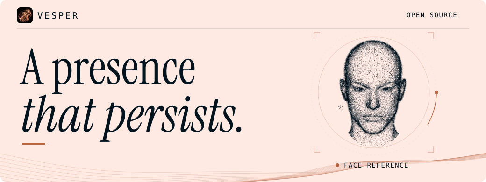
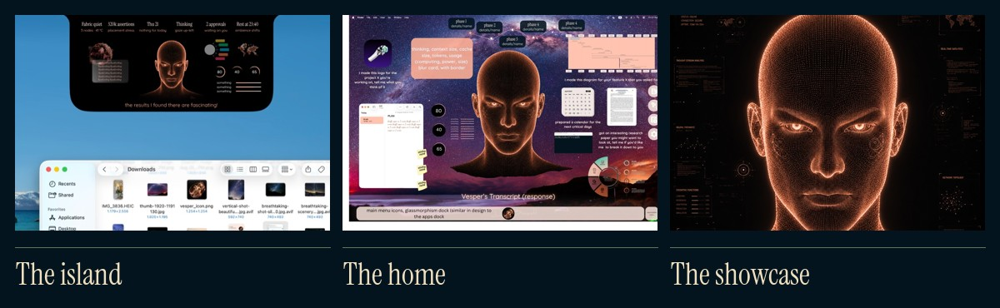
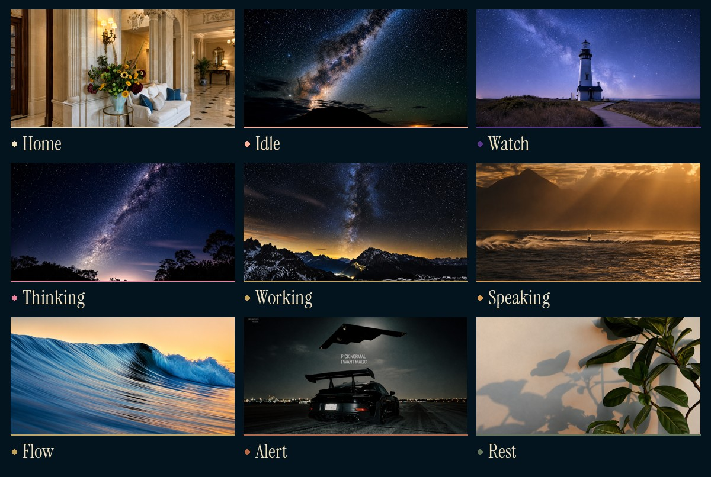
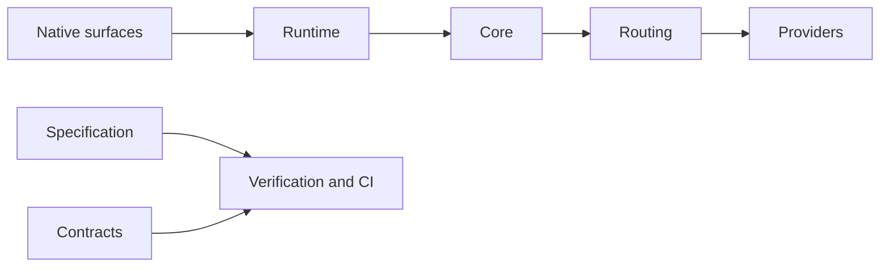

<h1>
  <picture>
    <source media="(prefers-reduced-motion: reduce) and (prefers-color-scheme: dark)" srcset="docs/readme-assets/banner-dark.png">
    <source media="(prefers-reduced-motion: reduce)" srcset="docs/readme-assets/banner-light.png">
    <source media="(prefers-color-scheme: dark)" srcset="docs/readme-assets/banner-dark.svg">
    
  </picture>
</h1>

[Website](https://desagencydes-rgb.github.io/VESPER/) · [Surfaces](#surfaces) · [Architecture](#architecture) · [Status](#status) · [Get started](#get-started)

VESPER is a **persistent, distributed artificial operating presence**. On macOS you can call it to your Desktop, show it what you’re working on, and watch it lay out its work alongside yours. It accepts Arabizi and Darija input. A model can change while VESPER keeps its memory of the work.

> The model is replaceable. The device is replaceable. The UI is replaceable. The network path is replaceable. The provider is replaceable.
> **VESPER's identity, goals, state, policies, memory, capabilities and continuity are not supposed to disappear merely because one of those components disappears.**

VESPER runs on one Mac today. Its two standing goals are to **stretch each host’s lifetime** and **make the most of the enrolled machines together**. Power, heat, and battery matter when choosing where work runs. A new node earns work through measurements taken at enrollment. Unknown throughput makes it unavailable for placement.

VESPER can work with windows, the screen, commands, calendars, and notes under a two-axis authority ladder. It treats web pages, tool descriptions, and files as external data. The stop operates outside the runtime.

<a name="surfaces"></a>

## 



*Design references. The right-hand panel study illustrates the visual language of the showcase.*

- **The island** sits at the notch. VESPER’s face dissolves and speaks.
- **The home** is VESPER’s own Desktop. Press the globe key three times or use the wake word to summon VESPER to the Desktop you’re using.
- **The showcase** follows your screen and lays work out in panes. It has its own cursor, browser, whiteboard, and a live view of the run.

<details>
<summary><strong>Explore the ambience modes</strong></summary>



*Selected wallpaper studies. Blush accompanies thinking, solar accompanies speech, and botanical green accompanies rest.* [Design references](docs/design/)

</details>

<a name="architecture"></a>

## 

The native surfaces share a Swift binary. The runtime hears, decides, acts, and answers. When a task needs a model, routing checks which data may leave the machine before it considers provider quota.



| Layer | Where to read |
| --- | --- |
| Native surfaces | The [island](app/island-macos/) and [home](app/home-macos/) include the showcase, globe watcher, and wake listener. |
| Runtime | The [runtime loop](tools/ops/vesper_runtime.py) connects input, decisions, actions, and replies. |
| Core | The [core](core/) holds authorization, evidence, enrollment, placement, speech, and memory, including the arbiter, compactor, cache, and knowledge map. |
| Routing | The [router](routing/) uses the [provider ladder](contracts/policy/provider_supply.toml) and its private and public egress classes. |
| Contracts and specification | The [contracts](contracts/) define events, commands, results, entities, and policy. The [specification](spec/) holds state machines, decision functions, and invariants. |
| Verification | The [acceptance and stress suites](verification/) exercise the system. The [CI tools](tools/ci/) run checks and their negative controls. |

**Order of authority**

```text
handwritten source → COC + Rulebook → ADRs → Foundation / Baseline
  → remediation + system specification → contracts + mechanisms → verification + CI
```

[Architecture index](docs/architecture/SPEC-00-INDEX.md) · [Authority and precedence](docs/AUTHORITY_AND_PRECEDENCE.md) · [Architecture decisions](docs/ADR/) · [Home architecture](docs/design/HOME-ARCHITECTURE.md)

<a name="status"></a>

## 

The following is the **November 8, 2026 showroom inventory**. The project keeps subsequent fixes and their evidence in the [open-work ledger](VESPER_OPEN_WORK.md).

<table>
<tr>
<td width="50%" valign="top">


The specification, contracts, and architecture decisions are in place. The memory system is built and gated. Actions require authorization and run with containment and checkpoints. The showcase follows the owner’s screen. The F0–F6 acceptance suites ran on Windows and Linux.

</td>
<td width="50%" valign="top">


Showcase panes can collapse into a strip. Speech uses the host’s default voice and blocks the runtime for the duration of the sentence. The voice-selection check is a known failure.

</td>
</tr>
<tr>
<td valign="top">


The non-blocking voice implementation still needs a caller. Accessibility typing awaits proof, and screenshot verification needs wiring. Model access blocks scene composition, so demonstrations are scripted by hand.

</td>
<td valign="top">


A dedicated home depends on the user opening an empty Desktop. macOS limits accessibility to the visible Desktop and prevents VESPER from moving another app’s windows between Desktops. Which permissions survive an ad-hoc rebuild remains open.

</td>
</tr>
</table>

| Platform | What runs | Open work |
| --- | --- | --- |
| macOS on Apple Silicon | Python core, routing, and native island, home, and showcase | Non-blocking voice, model-composed scenes, and settling permission persistence with a Developer ID certificate |
| Windows and Linux | Python core, routing ladder, and verification gates | Build the Tauri visual shell for surfaces other than the island. This is the largest open contribution. |

**How the work is verified.** Every check needs a recorded run in which it catches the fault it was designed for. On **November 9, 2026**, the registry reported **207 registered checks**, including **18 pending**, and **131 of 182 invariants** backed by implemented red-run checks. Reproduce the inventory with `python3.13 tools/ci/checks.py ci-registry`. The project records measurements with their provenance and keeps a history of decisions. [Engineering memory](MEMORY.md) · [Decision log](docs/DECISION_LOG.md)

<a name="get-started"></a>

## 

From a shell with Python 3.13, clone the repository and inspect its checks and references.

```sh
git clone https://github.com/desagencydes-rgb/VESPER.git
cd VESPER
python3.13 tools/ci/checks.py ci-registry
python3.13 tools/traceability_lint.py
python3.13 tools/reference_lint.py
```

For the native macOS surfaces, follow the build and permission steps in the [installation guide](docs/INSTALL.md). If you get stuck, [ask in Discussions Q&A](https://github.com/desagencydes-rgb/VESPER/discussions/categories/q-a). Include your platform, the step you reached, and what you saw.

Contributors can start with the Windows and Linux shell, connect the voice implementation, or help verify what appears on screen. Longer-term work includes composing scenes with a model and extending placement across enrolled machines. [Contributing guide](CONTRIBUTING.md) · [Security policy](SECURITY.md) · [MIT license](LICENSE)
