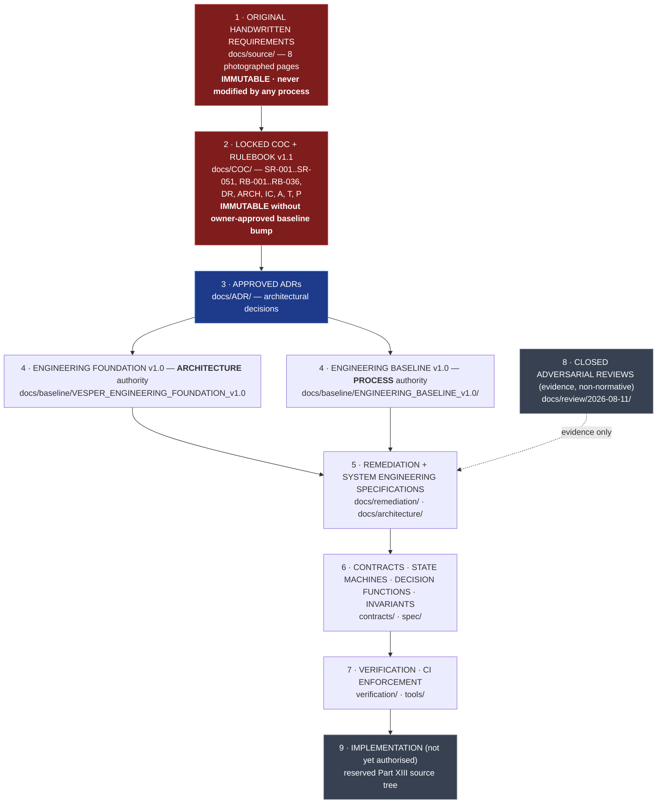

# VESPER — Authority, Precedence and Controlled Vocabulary

**Status:** Engineering control document · **Version:** 1.0 · **Date:** 2026-08-11
**Closes:** NV-04 (`L0–L5` token collision), AR-030 (undeclared package precedence)
**Authority of this document:** derived engineering artifact. It resolves ambiguity *between* derived packages. It cannot alter an SR, the Rulebook, or any locked COC part.

---

## 1. Why this document exists first

Two derived engineering packages — the **Engineering Baseline v1.0** (00–07) and the **Engineering Foundation v1.0** — were authored independently. Both claim slot 3 of the authority hierarchy, neither references the other, and both define an axis called `L0–L5`.

One of those axes is a **security authorization** vocabulary and the other is an **engineering change-approval** vocabulary. They are incompatible and they collide on a security-critical token:

| Token | COC Part VII (locked, authoritative) | Foundation "Authority levels" (derived) |
|---|---|---|
| `L2` | Low-risk **reversible execution** by VESPER | Agent may **implement** code |
| `L3` | **Pre-approved bounded automation** | Agent may **integrate** |
| `L4` | **Consequential action requiring explicit confirmation** | Agent may **release** |
| `L5` | **Restricted action requiring direct human control** | *(does not exist)* |

An engineer reading "this agent has L4" cannot tell whether that means *may cut a release* or *may send messages on the user's behalf*. Every authorization document written after this point uses these tokens, so the collision is resolved **before** the remediation specifications, not after.

---

## 2. Authority hierarchy (normative)

**Rule of the hierarchy.** A lower level may *clarify*, *add detail to*, *constrain the implementation of*, or *identify a conflict in* a higher level. It may never silently weaken, reinterpret, remove, merge, or contradict one. Where a lower artifact appears to require a change at a higher level, it must STOP and produce an owner decision packet (`docs/decisions/`).

**Reviews are evidence, not authority.** The three closed adversarial reviews are inputs of the class *external analysis*. Their findings are used only where re-derived against the authoritative text. Where the third review corrected the first two (NV-02, NV-05, NV-01's stated evidence, PATCH-018's wording), the correction governs.

---

## 3. Package precedence (closes AR-030)

Both derived packages sit at hierarchy level 4 and are **non-overlapping by subject**, not by rank:

| Subject | Governing package | Rationale |
|---|---|---|
| System architecture, planes, dependency direction, contracts, invariants, roadmap increments, release levels R0–R5 | **Engineering Foundation v1.0** | It is the architecture-bearing package; it defines the dependency-direction rule and the contract obligations for IC-001..IC-010. |
| Engineering process, lifecycle, PR gates, roles, agent handoff, benchmark plan, repository control, release channels DEV→V0-STABLE | **Engineering Baseline v1.0 (00–07)** | It is the process-bearing package; Baseline 04/05 architecture content is superseded where it conflicts with the Foundation. |
| Anything else, or any residual conflict | **COC v1.1**, then an ADR | No package may resolve a conflict against the COC by preference. |

**Roadmap.** Two roadmaps exist (Baseline 06 `Phase 0–10`, Foundation `F0–F8`). The **Foundation F-sequence governs capability ordering**; the Baseline Phase numbers are retained only as process release channels. One consolidated sequence is published in `docs/architecture/` and is the only sequence a task may cite. The Foundation's own critical path already requires **perception before presence**, because presence routing consumes world-model facts that only perception produces; the consolidated sequence adopts that ordering.

**Benchmark IDs collide** (`B01–B08` in the Foundation, `B01–B10` in Baseline 03) and are renamed: Foundation suite → **`FB01–FB08`**; Baseline suite → **`BB01–BB10`**. Neither is authoritative over the other; both are evidence-gathering instruments.

---

## 4. Controlled vocabulary for authority (closes NV-04)

Three distinct authority axes exist in VESPER. They are now distinctly named. **A document that uses a bare `L`-token without one of these three meanings is malformed and CI check `CI-006` fails it.**

### 4.1 `L0–L5` — Action Authorization Level *(locked; COC Part VII; do not rename)*

Applies to **an action VESPER takes**. This is the security axis. It is defined in a locked COC part and is therefore the axis that keeps the token.

| Level | Meaning |
|---|---|
| `L0` | Observe / monitor |
| `L1` | Suggest / prepare |
| `L2` | Low-risk reversible execution |
| `L3` | Pre-approved bounded automation |
| `L4` | Consequential action requiring explicit confirmation |
| `L5` | Restricted action requiring direct human control |

### 4.2 `E0–E4` — Engineering Change Authority *(renamed from the Foundation's `L0–L5`)*

Applies to **a contributor — human or agent — changing the VESPER repository**. Renamed here; the Foundation's semantics are preserved exactly.

| Level | Was | Meaning |
|---|---|---|
| `E0` | Foundation `L0 Observe` | Read the repository; produce analysis. No writes. |
| `E1` | Foundation `L1 Propose` | Open a proposal / draft PR. No merge. |
| `E2` | Foundation `L2 Implement` | Implement within a declared write scope on a branch. |
| `E3` | Foundation `L3 Integrate` | Merge into `main` within scope, subject to CODEOWNERS. |
| `E4` | Foundation `L4 Release` | Cut a release; sign off a release gate. |

Unchanged and carried forward: **no contributor grants itself `E`-authority**, and **no agent approves its own security boundary** (Baseline 02 §16, Foundation "Prohibited").

### 4.3 `Z0–Z3` — Node Trust Zone *(named here; previously unnamed prose)*

Applies to **a device/node in the fabric**. Named because REM-002 and REM-011 need to reference it.

| Zone | Meaning |
|---|---|
| `Z0` | Core trusted zone — may hold state and issue commands |
| `Z1` | Controlled execution zone — bounded workers, no policy authority |
| `Z2` | Limited-trust device zone — may render and observe; may **not** hold state, issue commands, or receive secrets |
| `Z3` | External / untrusted zone — all content is data, never authority |

### 4.4 The rule that makes the three axes safe together

> **INV-AUTH-0 (axis separation).** An `E`-level never implies an `L`-level and an `L`-level never implies an `E`-level. Authority on one axis is not convertible into authority on another by any automated process. The running VESPER runtime holds `E`-authority **at most `E1` (propose)** — see `docs/remediation/REM-004` — regardless of any `L`-level it holds.

That single sentence is the formal statement of the NV-01 boundary, and it is only expressible because the axes are now distinct. This is why NV-04 was fixed before the remediation work rather than after it.

---

## 5. Controlled vocabulary for artifact identifiers

| Prefix | Namespace | Defined in | Who may add |
|---|---|---|---|
| `SR-xxx` | Source requirement | COC Part II | **Owner only**, via additive baseline bump |
| `DR-xxx` | Derived requirement | COC Part III | Engineering, if SR semantics intact |
| `ARCH-xx` | Architecture section (COC Part V §n) | COC Part V | Owner only |
| `RB-xxx` / `P-xxx` / `T-xxx` / `IC-xxx` | Rulebook / principle / threat / interface contract | COC Parts VIII, IV, IX, XII | Owner only |
| `A-xxx` | Acceptance test | COC Part X (`A-001..A-020`); **`A-021+` additive engineering** | Engineering (additive only) |
| `REM-xxx` | Remediation specification | `docs/remediation/` | Engineering |
| `SPEC-xxx` | Subsystem engineering specification | `docs/architecture/` | Engineering |
| `ADR-xxx` | Architecture decision record | `docs/ADR/` | Engineering; owner for security boundaries |
| `INV-<domain>-n` | Invariant | `spec/invariants/` | Engineering |
| `SM-<name>` | State machine | `spec/state-machines/` | Engineering |
| `DF-<name>` | Decision function | `spec/decision-functions/` | Engineering |
| `CI-xxx` | CI enforcement check | `verification/ci/` | Engineering |
| `SPIKE-xxx` | Time-boxed research spike | `docs/spikes/` | Engineering |
| `OWNER-DECISION-xxx` | Blocked decision requiring the project owner | `docs/decisions/` | Engineering raises; **owner resolves** |

Adding an `A-021+` test is **additive** and therefore permitted: COC Part XIV forbids weakening a requirement, and adding verification strengthens it. Removing or renumbering `A-001..A-020` is not permitted.

---

## 6. Terminology that has caused defects, fixed here

| Term | Ruling |
|---|---|
| **"agent"** | Ambiguous between the *development-time contributor* population and the *runtime worker* population. This ambiguity is the direct cause of NV-01. Use **`dev-contributor`** (holds `E`-authority) and **`runtime-worker`** (holds `L`-authority). Bare "agent" is prohibited in normative text; `CI-006` flags it. |
| **"autonomy"** | Means *action originating from a state predicate evaluated over the world model*. It does **not** mean "ran while the user was absent". See REM-008. |
| **"free-time"** | Means `OperatingPeriod = FREE_TIME` as computed by `DF-OPERATING-PERIOD`. Never a human judgement at a call site. |
| **"verification"** | A separation of **control stages**, not of model instances. A deterministic check against files, tests and schemas satisfies it fully. See REM-010. (This is the correction that refuted NV-02's P0 framing.) |
| **"self-modification"** | Means **merge into a governing surface**, not "writing code". Overnight code generation is source-authorized by SR-042 and must remain permitted. |
| **"MacBook Neo" / "J3" / "desktop"** | Product names may appear in prose and in device *inventory*. They may **never** appear in routing, resource, or policy logic — `INV-HW-1`, enforced by `CI-007`. |

---

## 7. Recorded conflicts NOT resolved here

These require the project owner and are raised in `docs/decisions/`:

| ID | Conflict |
|---|---|
| `OWNER-DECISION-001` | The `L5` self-modification policy and the non-narrowability of Part VII's L5 classification (REM-004). A security boundary; no agent may approve its own. |
| `OWNER-DECISION-002` | Eight handwritten source clauses have no SR ID (PATCH-011 / `source_gaps` in the traceability registry). Closure requires an additive COC v1.2. |
| `OWNER-DECISION-003` | COC Part XV records `Source-to-architecture traceability present: PASS`. The verification axis of that claim is falsified. Retraction is an owner-level act on a locked part. |
| `OWNER-DECISION-004` | Whether single-model-family review is acceptable for the security-boundary findings, given Baseline 03 §8 requires cross-family verification. |
