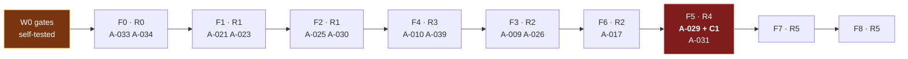

# VESPER — Consolidated implementation sequence

**Closes AR-030.** Two roadmaps existed: Foundation `F0–F8` and Baseline `Phase 0–10`. Per `docs/AUTHORITY_AND_PRECEDENCE.md §3`, the **Foundation F-sequence governs capability ordering**; Baseline Phase numbers are retained only as process release channels. This is the single sequence a task may cite.

**One ordering decision was made deliberately: perception before presence.** Presence routing consumes world-model facts that only perception produces — `DF-SELECT-ENDPOINT` cannot fail safe on "unknown person in the space" if nothing observes the space. The Baseline's own critical path already implies this; it is now stated.

## Sequence

| Stage | Release level | Content | Exit condition (an artifact that can fail) |
|---|---|---|---|
| **W0** | — | Repository, CI, branch protection, CODEOWNERS, contracts/, ADR structure. **Self-test every gate.** | Three deliberate violations fail red |
| **F0** | R0 | Runtime supervisor, config, telemetry, event bus, durable task state, checkpoints, persistence abstraction, policy skeleton | `A-002`, `A-019`, `A-033`, `A-034` pass **with their negative controls recorded** |
| **F1** | R1 | Model gateway + cost choke point, router, context manager, BAG/maps, memory, planner, verifier, resource governor | `A-003`, `A-004`, `A-006`, `A-021`, `A-022`, `A-023`, `A-032` |
| **F2** | R1 | Tool contract, capability registry, `DF-AUTHORIZE`, taint, execution, compensation, device registry | `A-013`, `A-014`, `A-024`, `A-025`, `A-030` |
| **F4** | R3 | **Perception + world model** — camera/audio/screen adapters, provenance, observation normalisation, sensor lifecycle, external observation ingress | `A-008`, `A-010`, `A-028`, `A-039`, `A-042` |
| **F3** | R2 | **Presence** — semantic scene, renderers, endpoint negotiation, migration, voice | `A-009` (three descriptors), `A-020`, `A-026`, `A-027`, `A-035` |
| **F6** | R2 | Distributed VESPER — discovery, authenticated comms, placement, migration, failure handling | `A-017`, `A-045`, `A-034` full |
| **F5** | R4 | **Autonomy** — trigger registry, evaluator sandbox, background worker, budgets, stop conditions, **safety interlock** | `A-011`, `A-012`, `A-029` **all three parts + C1 control**, `A-031`, `A-041`, `A-047` |
| **F7** | R5 | Environment — spatial topology, ambience, richer scenes | `A-046` |
| **F8** | R5 | Research engine, learning promotion, experiment registry | `A-015`, `A-016`, `A-040`, `A-044` |

**Note the swap:** F4 (perception/world) precedes F3 (presence). The Foundation's original numbering is retained so cross-references stay valid; the *order of execution* is the table's order.

## Blocking gate placement

**F5 is the decisive gate.** `A-029` part 3 with the C1 pure-cron negative control recorded as failing is the only artifact that demonstrates the anti-chatbot property is *tested* rather than asserted.

## Benchmark ID collision (resolved)

Foundation `B01–B08` → **`FB01–FB08`**. Baseline 03 `B01–B10` → **`BB01–BB10`**. Neither is authoritative over the other; both are evidence-gathering instruments.

## Research spikes

**Protocols live in `docs/spikes/`, registered in `docs/spikes/INDEX.toml`.** Each declares a measurable pass criterion and — decided in advance, so it is not decided under schedule pressure by whoever holds the failing number — what happens if it fails. `CI-050` fails any document referencing a spike with no protocol.

| Spike | Question | Blocks | Deliverable |
|---|---|---|---|
| **SPIKE-001** | Local model quality and sustained throughput per candidate machine; the **minimum viable profile** for SR-005 | Hardware purchase; `A-042` profile matrix | Measured `NodeCapabilityProfile` values + a declared minimum |
| **SPIKE-002** | Does SR-046 × SR-047 × RB-004 × SR-045 close on the minimum profile, offline, in `FREE_TIME`? | `A-020` feasibility | Per-stage budget with measured feasibility, **or** a Part XIV.3 limitation record — never a relaxed budget |
| **SPIKE-003** | Kernel/OS access per platform, at what privilege, under what entitlement | SR-026 disposition | Per-platform feasibility matrix |
| **SPIKE-004** | Optical feasibility envelope of the glass/holographic output | The `volumetric` ladder rung only — **contracts are not blocked** | Feasibility report + schema constraints |
| **SPIKE-005** | Programmatic call/FaceTime delegated presence without deceptive impersonation | SR-031 disposition | Feasibility report or Part XIV.3 record |
| **SPIKE-006** | Wi-Fi / RF through-wall sensing feasibility, accuracy, legality | SR-037 (R&D track only) | Already correctly scoped by DR-031 — the model the others follow |
| **SPIKE-007** | How long can a `foreground_only` node sustain the `INV-PLACE-3` survival core, and what survives OS suspension? | SR-060 depth on that node class; `A-048` survival cases | Measured suspension envelope; **zero torn durable writes** is the pass condition |
| **SPIKE-008** | Does the ADR-002 storage design deliver atomic epoch fencing and crash-safe checkpoints in budget? | `ADR-002` acceptance confidence; F0 increment 1 | Fencing and crash-trial results, **including the non-compliant read-then-write control run** |
