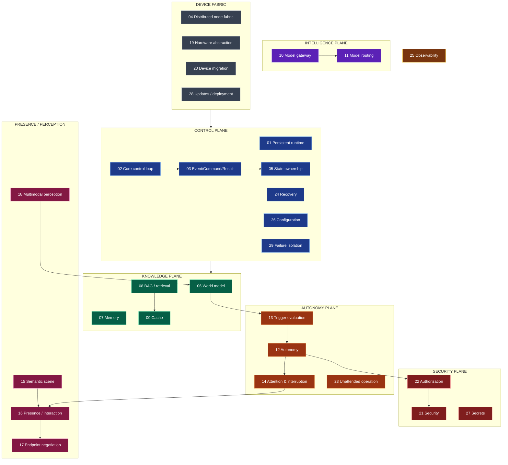

# VESPER System Engineering Specification — Index

**Status:** Implementation-grade specification · **Version:** 1.0 · **Date:** 2026-08-11
**Authority:** derived engineering artifact under `docs/AUTHORITY_AND_PRECEDENCE.md`. It may not weaken, reinterpret or remove any SR.

---

## How to read this specification

Each subsystem declares the same twenty fields. Where a mechanism is defined by a remediation spec, the subsystem **references** it rather than restating it — a duplicated mechanism is a mechanism that will drift.

**Every subsystem carries a `Jarvis-divergence` field** answering one question:

> *Could an implementation agent satisfy this specification while building an ordinary chatbot?*

with the answer and **the specific clause that prevents it**. A subsystem whose answer is "yes" is under-specified and must be strengthened before implementation. This makes the anti-chatbot property auditable rather than aspirational.

## Plane map

**Dependency direction is one-way:** `interfaces/contracts → domain state/policy → orchestration → adapters/providers/devices`. Core domain logic imports no vendor LLM SDK, device SDK, browser-automation library, or concrete database.

## Subsystem registry

| # | Subsystem | Document | Accountable owner | Primary REM |
|---|---|---|---|---|
| 01 | Persistent VESPER runtime | [SPEC-A](SPEC-A-control-and-distribution.md) | Core Systems Engineer | REM-002 |
| 02 | Core control loop | SPEC-A | Core Systems Engineer | REM-007 |
| 03 | Event / Command / Result | SPEC-A | Core Systems Engineer | REM-001 |
| 04 | Distributed node fabric | SPEC-A | Device/Network Engineer | REM-002, REM-011 |
| 05 | State ownership | SPEC-A | Core Systems Engineer | REM-002 |
| 24 | Recovery | SPEC-A | Core Systems Engineer | REM-002 |
| 29 | Failure isolation | SPEC-A | Core Systems Engineer | REM-002 |
| 06 | World model | [SPEC-B](SPEC-B-knowledge-and-intelligence.md) | World & Environment Engineer | REM-001, REM-011 |
| 07 | Memory | SPEC-B | Knowledge & Memory Engineer | REM-010 |
| 08 | BAG / context retrieval | SPEC-B | Knowledge & Memory Engineer | REM-010 |
| 09 | Cache architecture | SPEC-B | Knowledge & Memory Engineer | REM-003, REM-010 |
| 10 | Model gateway | SPEC-B | Intelligence Systems Engineer | REM-006 |
| 11 | Model routing | SPEC-B | Intelligence Systems Engineer | REM-006, REM-011 |
| 12 | Autonomy | [SPEC-C](SPEC-C-autonomy-and-presence.md) | Autonomy & Task Engineer | REM-007, REM-008 |
| 13 | Trigger evaluation | SPEC-C | Autonomy & Task Engineer | REM-007 |
| 14 | Attention and interruption | SPEC-C | Autonomy & Task Engineer | REM-007 |
| 15 | Semantic scene | SPEC-C | Presence & Interaction Engineer | REM-009 |
| 16 | Presence / interaction | SPEC-C | Presence & Interaction Engineer | REM-009 |
| 17 | Endpoint capability negotiation | SPEC-C | Presence & Interaction Engineer | REM-009, REM-011 |
| 18 | Multimodal perception | SPEC-C | Perception Engineer | REM-011 |
| 30 | Computer and device agency | SPEC-C | Autonomy & Task Engineer | REM-012, REM-011 |
| 19 | Hardware abstraction | [SPEC-D](SPEC-D-platform-security-operations.md) | Device/Network Engineer | REM-011 |
| 20 | Device migration | SPEC-D | Device/Network Engineer | REM-002 |
| 21 | Security | SPEC-D | Security Engineer | REM-003, REM-004, REM-005 |
| 22 | Authorization | SPEC-D | Security Engineer | REM-003 |
| 23 | Unattended operation | SPEC-D | Autonomy & Task Engineer | REM-005, REM-008 |
| 25 | Observability | SPEC-D | Verification Engineer | REM-012 |
| 26 | Configuration | SPEC-D | Core Systems Engineer | REM-004, REM-006 |
| 27 | Secrets | SPEC-D | Security Engineer | REM-003 |
| 28 | Updates / deployment | SPEC-D | Chief Architect | REM-004 (ADR-012) |

**Ownership rule.** One accountable owner per subsystem. Multiple contributors may write; acceptance ownership is singular. No contributor approves its own security boundary.

## The four artifacts that carry the anti-chatbot property

If an implementation gets these wrong, VESPER becomes *LLM + memory + tools + chat UI* while every stated rule still reads as satisfied:

| Artifact | Subsystem | Contract | The test that detects the degenerate build |
|---|---|---|---|
| **Semantic scene** | 15 | `semantic_scene.schema.json` | `A-009` — voice-only structural narration of a diagram; `A-026` — no text surface at all |
| **Trigger model** | 13 | `trigger.schema.json` | `A-029` part 3 — the anti-cron discriminator, with the C1 cron build recorded as failing |
| **World model** | 06 | `world_fact.schema.json` | `A-033.3` — an expired fact reads `UNKNOWN`, never "last known value" |
| **Endpoint episode** | 30 | `endpoint_interaction.schema.json` | `A-051` — the loop closes on the MACHINE; a build that closes it on the actuator's own report must FAIL |
