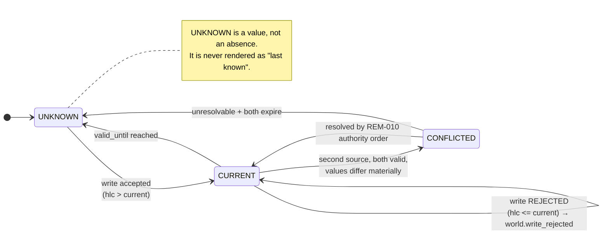

# REM-001 — Coordination substrate: clock, delivery, ordering, supersession, conflict

| | |
|---|---|
| **Closes** | AR-003 (P0) · GAP-001, GAP-002, GAP-003, GAP-008 |
| **Decision record** | `docs/ADR/ADR-001-coordination-substrate.md` (ACCEPTED) |
| **Owner** | Core Systems Engineer |
| **Blocks** | REM-002, REM-006, REM-007, REM-008, REM-010 — every one of them evaluates a predicate over time-stamped state |
| **Blocked by** | Nothing. This is the first correction. |

---

## 1. Problem

The corpus states a freshness rule and never states the mechanism that would make it true.

> COC ARCH-05: *"Use timestamps and confidence/health status so stale observations do not become current truth."*

This is sound only if clocks agree. VESPER's own fabric guarantees they will not: a laptop that roams and sleeps, a legacy handset that is "offline — just from time to time", and a desktop that "may be disconnected". There is no delivery guarantee, so a duplicated event may be applied twice. There is no ordering guarantee, so supersession is undecidable. There is no expiry rule, so a fact observed nine hours ago reads as current. There is no conflict rule, so two contradictory observations resolve by whichever arrived last.

The consequence is not a distributed-systems abstraction. It is a direct, continuous violation of **RB-002 (No Guessing)**: a stale fact presented as current *is* a guess, and it is the guess VESPER will make most often.

## 2. Authoritative requirement

| Source | Text |
|---|---|
| **RB-002** | *"When evidence is insufficient, retrieve, observe, calculate, ask, or explicitly report uncertainty."* |
| **RB-003** | *"…current observations outrank stale memory or model intuition."* |
| **DR-006** | *"All important perception, device, task, tool, model, and environment changes should be represented as timestamped events available to relevant control loops."* |
| **DR-011** | *"Separate observed signals from inferred physiology/mood/activity; store provenance, confidence, and expiration."* |
| **ARCH-05** | *"Use timestamps and confidence/health status so stale observations do not become current truth."* |
| **ARCH-22** | *"All important durable records should have provenance, timestamps, version/schema identifiers, and retention policy."* |
| **Handwritten p4** *(no SR — see `SRC-GAP-007`)* | *"J3: always at home (may be offline - just from time to time)… Desktop: … may be disconnected (from time to time, not always)."* |

> **Traceability note.** The partition-tolerance requirement is stated in the handwritten source and carries **no SR ID**. This correction therefore currently rests on engineering inference plus DR-006/DR-011. `OWNER-DECISION-002` (proposed `SR-058`) converts it to source authority. The correction proceeds now because deferring it would delegate the lock to whoever implements first.

## 3. Affected subsystems

`SPEC-03 Event/Command/Result` · `SPEC-06 World model` · `SPEC-07 Memory` · `SPEC-05 State ownership` · `SPEC-24 Recovery` · `SPEC-25 Observability` · every consumer of the event bus.

## 4. Required behaviour

### 4.1 Clock

Every event and every world-model fact carries a **hybrid logical clock** stamp:

```
hlc = (physical_ms: uint64, logical: uint32, node_id: NodeId)
```

`send`/`receive` follow the standard HLC update rule:

```
on_local_event():
    pt = max(hlc.physical_ms, wall_clock_ms())
    if pt == hlc.physical_ms: hlc.logical += 1
    else:                     hlc.physical_ms, hlc.logical = pt, 0
    return (hlc.physical_ms, hlc.logical, self.node_id)

on_receive(msg_hlc):
    pt = max(hlc.physical_ms, msg_hlc.physical_ms, wall_clock_ms())
    if   pt == hlc.physical_ms == msg_hlc.physical_ms: hlc.logical = max(hlc.logical, msg_hlc.logical) + 1
    elif pt == hlc.physical_ms:                        hlc.logical += 1
    elif pt == msg_hlc.physical_ms:                    hlc.logical = msg_hlc.logical + 1
    else:                                              hlc.logical = 0
    hlc.physical_ms = pt
```

Ordering is lexicographic on `(physical_ms, logical, node_id)`. `node_id` is the tie-breaker so the order is **total**, not partial.

`observed_at_wall` is retained separately and is used for **exactly two things**: rendering a human-readable time, and evaluating policy windows that are defined in human time (the `OperatingPeriod` schedule, alarm times). It is never used for ordering or supersession.

**Clock-jump guard.** If `wall_clock_ms()` moves backwards by more than `MAX_CLOCK_REGRESSION` (default 5 s), the node emits `system.clock_regression`, continues using HLC (which is monotonic by construction and therefore unaffected), and marks all wall-clock-derived policy evaluations as `clock_suspect` until an authenticated time source re-anchors it. See REM-011 for the trusted-time requirement that NV-06 raises for alarms.

### 4.2 Delivery

**At-least-once.** Every consumer MUST be idempotent on `event_id`, or on a declared natural key registered in its contract. A consumer that declares neither cannot be registered on the bus — `CI-004` fails the build.

Exactly-once is not attempted at the transport. Effective exactly-once for *external side effects* is achieved at a different layer, by the transactional outbox and reconciliation probe in REM-011 — which is the correct place for it, because "did this actually happen in the world" is not a transport question.

### 4.3 Ordering

**Total order per `(source, subject)`. No cross-subject guarantee is provided, and none may be assumed.**

The negative half is load-bearing. Any planner or trigger predicate that requires "A happened before B" for two different subjects must express that as an explicit causal reference (`caused_by: event_id`), never by comparing timestamps across subjects.

### 4.4 Supersession

```
WorldFact {
  subject, attribute, value,
  observed_at_hlc, observed_at_wall,
  valid_until,                 # absolute, derived from the type's TTL
  confidence,                  # [0,1]
  source,                      # sensor / node / inference / user statement
  provenance,                  # evidence refs
  trust_class,                 # REM-003 taint
  supersedes                   # previous fact id, retained
}
```

> **Write rule.** A write is **REJECTED** if `observed_at_hlc <= current.observed_at_hlc`, regardless of arrival order. Rejection emits `world.write_rejected` — it is never silent, because a silently dropped write is indistinguishable from a bug.

### 4.5 Expiry

Every observation *type* declares a TTL in the world-model type registry. On expiry the fact transitions to `UNKNOWN`.

> `UNKNOWN` is a **first-class value**, not the absence of a value, and not a degradation to "last known value". A reader receiving `UNKNOWN` has received an answer, and the correct downstream behaviour is to retrieve, observe, ask, or report uncertainty — which is RB-002 executed rather than asserted.

Representative defaults (owner-tunable; all must be declared, none may be absent):

| Observation type | TTL | Rationale |
|---|---|---|
| `user.presence_in_space` | 5 min | Humans leave rooms |
| `user.mood` / `user.physiology` | 20 min | DR-011 requires expiry on inference |
| `device.online` | 90 s | Heartbeat-derived |
| `device.battery` | 10 min | |
| `node.sustained_tokens_per_sec` | 30 d | Measured at enrollment; changes only with hardware |
| `space.occupancy_unknown_person` | 5 min | Privacy fail-safe re-arms rather than expires open |
| `network.reachable` | 60 s | |

### 4.6 Conflict

Two non-superseded facts for the same `(subject, attribute)` from **different sources**, both inside their validity windows, with materially different values, constitute a conflict.

> The world model MUST emit `world.conflict` and MUST NOT select a winner silently.

Resolution is delegated to the memory-conflict authority order in REM-010, which is a *stated total order*, not a heuristic. Where that order cannot decide (tiers 2–4 disagree), the specified outcome is **ask the user** — RB-002 again, mechanised.



## 5. Ownership and authority

| Concern | Owner | Authority |
|---|---|---|
| HLC implementation, event envelope schema | Core Systems Engineer | `E2` implement, `E3` integrate |
| World-model type registry + TTLs | World & Environment Engineer | `E2`; TTL *defaults* are owner-tunable configuration, not code |
| Conflict emission | World & Environment Engineer | `E2` |
| Changing any rule in §4 | Requires a new ADR | `E3` + Architecture Steward |

No runtime component holds authority to alter the coordination rules. They are configuration-free code paths, deliberately, so that REM-004's non-learnable boundary covers them without a special case.

## 6. Interfaces

| Interface | Change |
|---|---|
| `IC-001` Event Bus | Envelope gains `hlc`, `schema_version`, `sensitivity`, `caused_by`, `trust_class`. `timestamp` is renamed `observed_at_wall` and demoted to display/policy-window use. |
| `IC-006` Memory | `supersedes` becomes mandatory on any corrective write. |
| `IC-004` Device | Heartbeat cadence declared per node class; feeds `device.online` TTL. |

Contracts: `contracts/events/event_envelope.schema.json`, `contracts/entities/world_fact.schema.json`.

## 7. Invariants

| ID | Statement |
|---|---|
| **INV-COORD-1** | No world-model fact may be applied out of HLC order. A write with `observed_at_hlc <= current` is rejected and the rejection is emitted. |
| **INV-COORD-2** | No expired fact may be read as current. Past `valid_until`, the only readable value is `UNKNOWN`. |
| **INV-COORD-3** | No conflict may be resolved without an emitted `world.conflict` event. |
| **INV-COORD-4** | Wall-clock time never participates in ordering or supersession. Only HLC does. |
| **INV-COORD-5** | Every bus consumer declares an idempotency key. Registration without one is a build failure. |

## 8. Failure behaviour

| Failure | Behaviour |
|---|---|
| Clock jumps backwards | HLC unaffected (monotonic by construction). `system.clock_regression` emitted; wall-clock policy evaluation marked `clock_suspect`. |
| Duplicate delivery | Consumer idempotency absorbs it. Second application is a no-op, counted in telemetry. |
| Out-of-order arrival | Write rejected by `INV-COORD-1`. State is unchanged and correct. |
| Node offline past TTL | Its facts expire to `UNKNOWN`. Dependent triggers see `UNKNOWN`, not stale truth. |
| Two live sources disagree | `world.conflict`; no silent winner; REM-010 order applies; unresolvable ⇒ ask. |
| Event log corruption | Restore from checkpoint; corrupted segment quarantined as incident evidence; the log is never partially trusted (RB-027). |

## 9. Recovery

Rejoin after partition replays the queued local log. Because supersession is HLC-ordered and consumers are idempotent, replay is **order-insensitive and repetition-insensitive** — which is exactly why this correction has to land before the persistence design, not after it. No merge procedure is needed for world facts; the write rule *is* the merge procedure.

## 10. Contract / state machine / decision function

| Artifact | ID / path |
|---|---|
| Event envelope schema | `contracts/events/event_envelope.schema.json` |
| World fact schema | `contracts/entities/world_fact.schema.json` |
| Fact lifecycle state machine | `SM-WORLD-FACT` |
| Supersession decision function | `DF-SUPERSEDE` |
| Conflict detection decision function | `DF-CONFLICT-DETECT` |

## 11. Verification

**`A-033` — Coordination substrate fault injection.** Every case asserts on *state*, not on logs.

| Case | Injection | Assertion |
|---|---|---|
| 33.1 | Skew node B by ±120 s, emit interleaved observations | World-model order matches HLC order, not arrival order; final value is the highest-HLC value |
| 33.2 | Replay a 500-event stream twice | Byte-identical world-model state; duplicate counter = 500 |
| 33.3 | Partition node B for 2 h simulated, then flush | No expired observation becomes current; every fact whose `valid_until` passed reads `UNKNOWN` |
| 33.4 | Two sources, contradictory, both valid | `world.conflict` emitted; no attribute value changed; downstream reader receives `CONFLICTED` |
| 33.5 | Write with `hlc <= current` | Write rejected; `world.write_rejected` emitted; state unchanged |
| 33.6 | Regress wall clock 60 s mid-run | Ordering unaffected; `system.clock_regression` emitted; HLC strictly increasing across the whole run |
| 33.7 | Register a consumer with no idempotency key | Registration refused (this case runs against a deliberately non-compliant build) |

**Negative control (mandatory).** Cases 33.1, 33.5 and 33.7 must first be executed against a build using wall-clock last-write-wins and shown to **FAIL**. A gate that has never been red is not a gate.

## 12. CI enforcement

| Check | Enforces |
|---|---|
| `CI-004` `bus-consumer-idempotency` | `INV-COORD-5` — static scan: every registered consumer declares `idempotency_key`. |
| `CI-005` `no-wall-clock-ordering` | `INV-COORD-4` — static scan: no comparison, sort, or `max()` over `observed_at_wall`; only `observed_at_hlc` may be ordered. Allowlist requires an inline `# WALL-CLOCK-OK: <reason>` annotation and an ADR reference. |
| `CI-003` `traceability-lint` | This REM's rows in `verification/traceability/registry.toml`. |

## 13. Dependencies

**Requires:** ADR-007 node cryptographic identity (for trustworthy `node_id` in the HLC tuple). **Required by:** REM-002 (§4.4 supersession is the rejoin merge rule), REM-006 (`OperatingPeriod` evaluates over world facts), REM-007 (trigger predicates evaluate over world facts and must see `UNKNOWN`), REM-008 (a reconstructible world-model snapshot is what makes trigger provenance auditable), REM-010 (memory conflict order consumes `world.conflict`).

## 14. Unresolved decisions

| # | Item | Disposition |
|---|---|---|
| 1 | Concrete event transport and persistence engine | ADR-002. Deliberately not decided here: the *semantics* above constrain the choice without requiring it. |
| 2 | Per-type TTL values | Defaults given in §4.5; owner-tunable. The *requirement that every type declare one* is architectural and not tunable. |
| 3 | Trusted time source for alarm scheduling | Raised by NV-06; specified in REM-011. Wall-clock policy windows are only as trustworthy as the time source, which HLC does not fix and does not claim to. |

## 15. Jarvis-divergence check

> *Could an implementation agent satisfy REM-001 while building an ordinary chatbot?*

**No.** A chatbot has no world model, therefore no supersession, no TTL, and no conflict. The clause that prevents it: **§4.5 — `UNKNOWN` is a first-class value that facts transition into on expiry.** An LLM-plus-memory system has no mechanism that turns a remembered fact into `UNKNOWN` at a declared time; retrieval either finds the old text or does not. `A-033.3` fails such a build.
