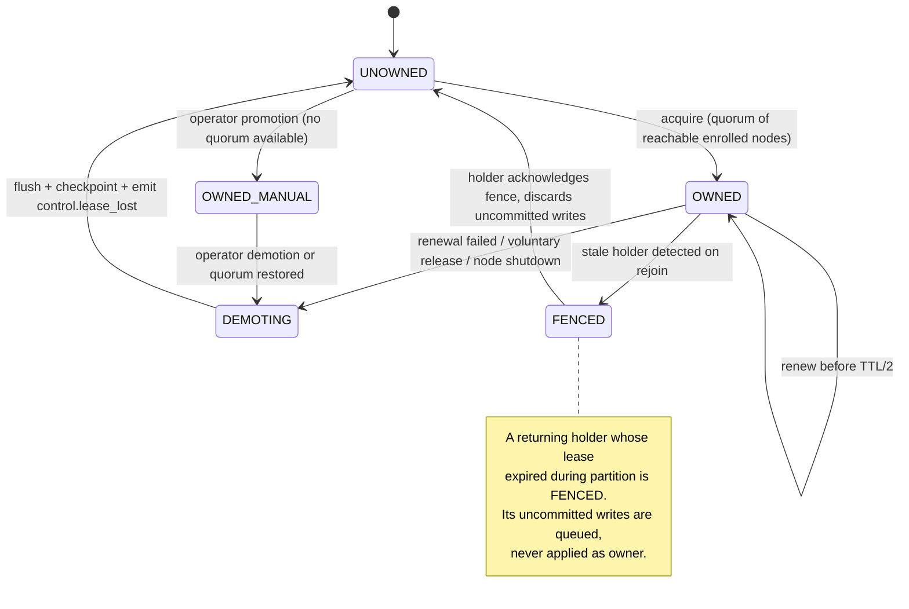
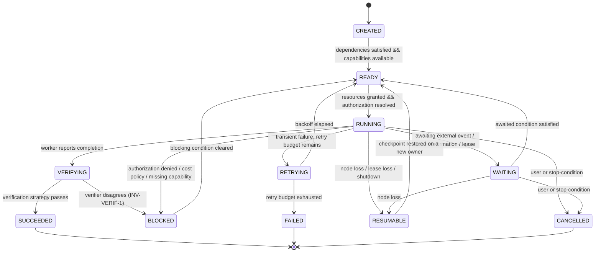

# REM-002 — Control-plane topology, state ownership, partition and failover

| | |
|---|---|
| **Closes** | AR-002 (P0) · AR-009 (P0, the ADR-002/ADR-012 half) · GAP-004, GAP-005, GAP-006, GAP-007, GAP-009, GAP-010 |
| **Decision records** | `docs/ADR/ADR-012-deployment-topology.md` (ACCEPTED, bounded) · `docs/ADR/ADR-002-persistence.md` (**PROPOSED** — `INV-ADR-1` blocks F0 until accepted) |
| **Owner** | Core Systems Engineer (leases, persistence) · Device/Network Engineer (quorum, reachability) |
| **Blocked by** | REM-001 — rejoin merge *is* HLC supersession |
| **Blocks** | REM-004 (needs the deployment boundary), REM-006, REM-007, REM-011 |

---

## 1. Problem

COC Part XVI makes the headline claim of the whole system:

> *"Vesper's identity, goals, state, policies, memory, capabilities, and continuity are not supposed to disappear merely because one of those components disappears."*

There is no mechanism behind it. The handwritten source designates the desktop as *"main assistant's space if Macbook not available"* — a **promotion** — with no election rule, no lease, no partition rule, and no definition of what a non-owning node may do. Without leases, two nodes write the same task and diverge silently, and nothing detects it.

The Foundation compounded this by filing deployment topology, persistence engine and event transport as *"Intentionally unresolved"* while making increment #2 *"Event contract + durable task state"* — a decision that cannot be deferred, only delegated to whoever implements first.

## 2. Authoritative requirement

| Source | Text |
|---|---|
| **DR-002** | *"Vesper identity/state must persist independently of any single model process, device, UI, or session."* |
| **DR-007** | *"Tasks survive model/device transitions and can resume from checkpoints."* |
| **DR-017** | *"Protect system state with backups, checkpoints, rollback, and node failover."* |
| **DR-022** | *"Vesper optimizes for continuity of user goals, not continuity of a particular model or device."* |
| **RB-008** | *"Preserve active goals and state across models, nodes, and sessions whenever possible."* |
| **ARCH-24** | *"Node loss: reroute to another authorized node."* |
| **SR-019** | MacBook Neo main; desktop secondary/additive **or fallback**; iPhone additive when other hardware unavailable |
| **Handwritten p4** *(`SRC-GAP-007`)* | Desktop *"could work as … main assistant's space if Macbook not available"* |

## 3. Affected subsystems

`SPEC-01 Persistent runtime` · `SPEC-04 Distributed node fabric` · `SPEC-05 State ownership` · `SPEC-20 Device migration` · `SPEC-24 Recovery` · `SPEC-29 Failure isolation` · `SPEC-13 Trigger evaluation` (autonomy queue is a leased domain).

## 4. Required behaviour

### 4.1 State-domain ownership

Seven domains. **Exactly one lease holder per domain at any instant.** Domains are leased independently, so the MacBook may own `tasks` while the desktop owns `world`.

| Domain | Contents | Non-owner behaviour | Rejoin conflict rule |
|---|---|---|---|
| `tasks` | Task graph, checkpoints, task state | `QUEUE_WRITES` | Outbox reconciliation (REM-011) |
| `world` | World-model facts | `READ_CACHED` (marked stale) + `QUEUE_WRITES` | Supersession-wins (REM-001 §4.4) |
| `memory` | Durable memory records | `READ_CACHED` + `QUEUE_WRITES` | Supersession-wins |
| `devices` | Device registry, trust state, enrollment | `READ_CACHED` | **Owner-wins** |
| `policy` | Authorization policy, cost policy, grants | **`REFUSE`** | **Owner-wins** |
| `autonomy_queue` | Pending autonomous work, trigger registry state | `REFUSE` | Owner-wins |
| `alarms` | Scheduled alarms, escalation state | `REFUSE` for *edits*; **fire is exempt** (§4.5) | Owner-wins for edits; duplicate-tolerant for fires |

`REFUSE` is the default for `policy`, `autonomy_queue` and `alarms` because a queued policy write applied minutes later, after the situation changed, is worse than a refusal the caller can observe.

### 4.2 Lease lifecycle

**Fencing.** Every write to a leased domain carries the `lease_epoch` under which it was authorized. The storage layer rejects any write whose `lease_epoch` is older than the current epoch. This is what makes "never automatic on partition alone" enforceable rather than aspirational: a partitioned ex-owner that keeps writing locally cannot have those writes accepted on rejoin.

### 4.3 Promotion

| Condition | Behaviour |
|---|---|
| Clean lease expiry **and** quorum of reachable enrolled nodes | **Automatic** promotion of the designated standby |
| Lease expiry **without** quorum | **MANUAL** only. Emit `control.promotion_requires_operator`. Continue in degraded mode. |
| Partition detected (both sides live) | **No promotion on either side.** Both sides operate under §4.4. |

> **The rule that prevents split-brain:** partition is not evidence of failure. A node that cannot see its peers cannot distinguish "they are down" from "I am isolated", so it must never resolve that ambiguity in its own favour.

### 4.4 Partition behaviour

A disconnected node:

- **MAY** execute already-authorized local work (SR-042's overnight work survives a network drop);
- **MUST** queue `world` and `memory` writes with their HLC stamps;
- **MUST NOT** issue external actions at `L4` or above;
- **MUST NOT** self-promote;
- **MUST** report degraded capability to the user when a surface is available (RB-022, DR-021).

The `L4`+ prohibition is the important one. An external action taken during partition cannot be deduplicated against what the other side did, and external actions are the irreversible class.

### 4.5 The `alarms` exception

Alarms invert the failure direction. A missed wake-up violates SR-043; a duplicate wake-up is an annoyance.

> **On partition: FIRE.** Alarms are replicated to every capable node. Where connectivity permits, lease-based single-firer election suppresses duplicates. Where it does not, every capable node fires and the acknowledgement path is duplicate-tolerant. **Never fire-never.**

This is the single place in VESPER where availability is chosen over consistency, and it is chosen deliberately because the source requirement is explicit that the user is a heavy sleeper and the system *"must not stop"*.

### 4.6 Task state machine

COC/Baseline 04 §5 names states and defines no transitions, so no two implementations would agree. The transition table is normative:

**Guards that are not optional:**

- `VERIFYING → SUCCEEDED` requires a passing `VerificationStrategy` (REM-010). There is **no** direct `RUNNING → SUCCEEDED` edge. A worker's own claim of completion is not a transition.
- `VERIFYING → BLOCKED` on verifier disagreement. Re-running until the verifier agrees is prohibited (`INV-VERIF-1`).
- `RESUMABLE` is entered by *losing a node*, never by a decision. It is the state that makes DR-007 true.

### 4.7 Checkpoints

| Property | Rule |
|---|---|
| Granularity | Every completed plan step, and every `≥ CHECKPOINT_INTERVAL` (default 60 s) during a long step |
| Content | Task goal, plan, completed steps + their results, evidence refs, grant references (**never grant secrets**), outbox cursor, resource consumption, `lease_epoch` |
| Excluded | Model context windows, raw media, secrets. A checkpoint is a *resumption* record, not a memory dump. |
| Resume semantics | Resume replays from the **outbox cursor**, never from the plan start. External effects already recorded are reconciled (REM-011), not repeated. |
| Durability | Checkpoint write is `≤ 200 ms` (REM-010 latency budget) and is acknowledged before the step is marked complete |

## 5. Ownership and authority

| Concern | Owner | Authority |
|---|---|---|
| Lease protocol, fencing, epochs | Core Systems Engineer | `E2`/`E3` |
| Quorum and reachability determination | Device/Network Engineer | `E2` |
| Promotion policy values (TTL, quorum size) | Project Owner | Configuration under owner-only change control |
| Manual promotion in a no-quorum partition | **Human operator only** | Not automatable, by decision D2.5 |
| `alarms` failure direction | Project Owner | Recorded in ADR-012; changing it is a safety decision |

## 6. Interfaces

| Interface | Change |
|---|---|
| `IC-004` Device | Adds `roles: [control_candidate, ...]`, `expected_availability`, `always_on`, reachability heartbeat |
| `IC-007` Task | Adds `lease_epoch`, `checkpoint_ref`, `outbox_cursor`; state transitions become explicit per §4.6 |
| `IC-009` Security | Adds `lease_epoch` to the audit record so authority-at-time-of-action is reconstructible (A-018) |
| New | `control.lease_acquired` / `control.lease_lost` / `control.promotion_requires_operator` / `control.fenced` events |

Contracts: `contracts/entities/lease.schema.json`, `contracts/entities/task.schema.json`, `contracts/entities/checkpoint.schema.json`.

## 7. Invariants

| ID | Statement |
|---|---|
| **INV-OWN-1** | Every state domain has exactly one lease holder at any instant. A node without the lease may not write to that domain. |
| **INV-OWN-2** | A partitioned node may not self-promote and may not issue `L4`+ external actions. |
| **INV-OWN-3** | Every write to a leased domain carries a `lease_epoch`; writes with a stale epoch are rejected at the storage layer (fencing). |
| **INV-OWN-4** | `policy`, `autonomy_queue` and `alarms` refuse non-owner writes rather than queueing them. |
| **INV-TASK-1** | There is no `RUNNING → SUCCEEDED` transition. `SUCCEEDED` is reachable only through `VERIFYING` with a passing strategy. |
| **INV-TASK-2** | Resume replays from the outbox cursor, never from plan start. |
| **INV-ALARM-1** | An alarm has exactly one firer per instant where connectivity permits; on partition the failure direction is **fire**, not skip. |
| **INV-ADR-1** | No change under `core/`, `tasks/` or `memory/` may merge while ADR-001, ADR-002 or ADR-012 is not ACCEPTED. |

## 8. Failure behaviour

| Failure | Behaviour |
|---|---|
| Lease renewal fails (network blip) | Holder self-demotes at TTL, flushes, checkpoints, emits `control.lease_lost`. It does **not** keep writing hopefully. |
| Standby cannot reach quorum | No promotion. `control.promotion_requires_operator`. Read-only degraded mode; user informed. |
| Both sides live and partitioned | Neither promotes. Both queue. `L4`+ suppressed on both. Alarms fire on both. |
| Stale ex-owner rejoins | `FENCED`; its uncommitted writes are queued as ordinary writes and subject to supersession; nothing is applied with owner authority. |
| Node loss mid-task | Task → `RESUMABLE`; new owner restores checkpoint; outbox cursor prevents duplicate external effects. |
| Checkpoint corruption | Restore the previous checkpoint; corrupted one preserved as incident evidence; task re-enters `RESUMABLE`, never `SUCCEEDED`. |
| Persistent-store corruption | Isolate, preserve evidence, restore known-good, replay log from the last good checkpoint (RB-027). |

## 9. Recovery

Recovery is *ordinary operation running backwards*, not a separate subsystem: promotion is a lease acquisition; resume is a checkpoint restore; rejoin is a supersession-ordered replay. That is deliberate — a recovery path exercised only during incidents is a recovery path that does not work.

**Rejoin conflict resolution order** is stated in §4.1 per domain, and is the only place in the system where "owner-wins" applies. It applies exactly where the data is *authoritative configuration* (`policy`, `devices`) rather than *observation* (`world`, `memory`).

## 10. Contract / state machine / decision function

| Artifact | ID / path |
|---|---|
| Lease schema | `contracts/entities/lease.schema.json` |
| Task schema | `contracts/entities/task.schema.json` |
| Checkpoint schema | `contracts/entities/checkpoint.schema.json` |
| Lease lifecycle | `SM-LEASE` |
| Task lifecycle | `SM-TASK` |
| Promotion decision | `DF-PROMOTE` |
| Non-owner write disposition | `DF-DOMAIN-WRITE` |

## 11. Verification

**`A-034` — Control-plane ownership, failover and partition.**

| Case | Injection | Assertion |
|---|---|---|
| 34.1 | Clean departure of the lease holder | Standby promotes; task resumes from checkpoint; **alarm ownership transfers exactly once** |
| 34.2 | Partition with both sides live | No double external action; no divergent task state on rejoin; both sides refused `L4`+ |
| 34.3 | Stale ex-owner rejoins after TTL | Writes rejected by fencing; `control.fenced` emitted; degradation and reconciliation events present |
| 34.4 | Lease expiry with no quorum | No automatic promotion; `control.promotion_requires_operator`; system degrades read-only rather than splitting |
| 34.5 | Kill the node mid-`RUNNING` | Task → `RESUMABLE`; resume replays from outbox cursor; the already-sent external action is **not** repeated |
| 34.6 | Write to `policy` from a non-owner | Refused, not queued |
| 34.7 | Force `RUNNING → SUCCEEDED` in a non-compliant build | Rejected by `SM-TASK`; this case must be shown FAILING against a build with the illegal edge |

**Negative control.** 34.2, 34.3 and 34.7 must be demonstrated red against a deliberately non-compliant build before the suite is trusted.

## 12. CI enforcement

| Check | Enforces |
|---|---|
| `CI-008` `adr-gate` | `INV-ADR-1` — a change under `core/`, `tasks/`, `memory/` fails while ADR-001/002/012 are not ACCEPTED |
| `CI-009` `leased-write-epoch` | `INV-OWN-3` — static scan: every write path into a leased domain passes a `lease_epoch` |
| `CI-010` `task-transition-table` | `INV-TASK-1` — the implemented transition set must equal `SM-TASK` exactly; extra edges fail |

## 13. Dependencies

**Requires:** REM-001 (supersession is the rejoin merge rule), ADR-002 (persistence engine), ADR-007 (node identity for quorum membership). **Required by:** REM-004 (deployment boundary), REM-006 (`OperatingPeriod` is control-plane state), REM-007 (`autonomy_queue` is a leased domain), REM-011 (outbox, alarms).

## 14. Unresolved decisions

| # | Item | Disposition |
|---|---|---|
| 1 | Persistence engine (concrete) | ADR-002. Constrained here: must support atomic epoch-fenced writes and durable append-only log. |
| 2 | Lease TTL, renewal interval, quorum size | Owner configuration. Bounded by "never automatic on partition alone". |
| 3 | Whether the J3 may be a `control_candidate` | **No** — resolved by REM-011: the J3 is `Z2 limited_trust` and `Z2` may not hold state. Recorded so it is not re-litigated. |
| 4 | iPhone continuity role | **No continuity-critical capability may be assigned solely to a foreground-only node** (REM-011). |

## 15. Jarvis-divergence check

> *Could an implementation agent satisfy REM-002 while building an ordinary chatbot?*

**No.** A chatbot has one process and no state ownership question. The clause that prevents it: **§4.6 — there is no `RUNNING → SUCCEEDED` edge, and `RESUMABLE` is entered by losing a node.** A chat backend that restarts loses the conversation and calls that acceptable; `A-034.5` requires a task to survive the death of the machine it was running on and resume without repeating its external effects. No prompt-driven architecture satisfies that by accident.
