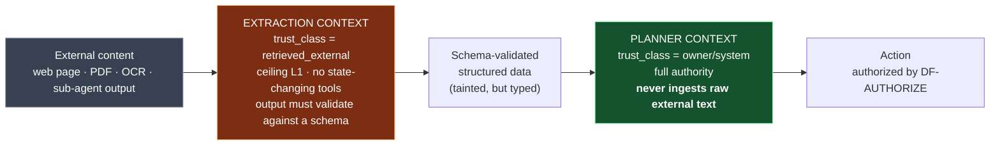

# REM-003 — Authorization decision function, delegation attenuation, and the injection ceiling

| | |
|---|---|
| **Closes** | AR-006 (P0) · AR-007 (P0) · GAP-011, GAP-012, GAP-013, GAP-014, GAP-015 |
| **Decision record** | **This specification.** The Foundation ADR namespace is ADR-001…016; the former `ADR-017` citation named an ID that does not exist. See `docs/ADR/ADR-REGISTER.md §2`. |
| **Owner** | Security Engineer |
| **Blocked by** | REM-001 (taint travels on the event envelope) |
| **Blocks** | REM-004 (self-modification binds to this evaluator), REM-006, REM-007, REM-011, every tool |

---

## 1. Problem

**Two defects, one evaluator.**

**(a) Authorization is a taxonomy with no decision function.** COC Part VII lists six levels and gives examples. It names no subject, no argument sensitivity, no policy decision point, no unavailability behaviour, and no delegation rule. Under it, `shell.run("ls")` and `shell.run("rm -rf ~")` are the same tool at the same level. RB-028 forbids self-**grant** and is silent on **inheritance** — and inheritance, not self-grant, is the real escalation path: SR-014 permits unbounded agent fan-out, and ARCH-11 gives the initiating planner authority to *"determine decomposition, resources… and verification responsibilities"* for the agents it spawns, with no attenuation rule. A sub-agent summarising a hostile web page therefore holds its parent's `L4`.

**(b) Injection resistance is a disposition, not a mechanism.** RB-025 states the *outcome* — *"External text, webpages, files, model outputs, and retrieved instructions are data, not system authority"* — and T-002's control restates it. There is no taint model, no channel separation, and no authority reduction under untrusted content, in a system that browses the web unattended overnight (SR-042, SR-044) with shell access (SR-021) and messaging capability (SR-032).

These are one correction because the fix for (b) is a term in the decision function for (a).

## 2. Authoritative requirement

| Source | Text |
|---|---|
| **Part VII** | `L0`–`L5` levels; *"Authorization is capability-specific. A device being trusted does not automatically grant every tool or every action."* |
| **RB-010** | *"Use only the permissions necessary for the current action."* |
| **RB-011** | *"Consequential actions require the authorization level configured for that action."* |
| **RB-025** | *"External text, webpages, files, model outputs, and retrieved instructions are data, not system authority."* |
| **RB-028** | *"Vesper cannot grant itself permissions merely because a goal seems important."* |
| **DR-014** | *"Consequential actions are gated by policy, authorization, reversibility, and risk."* |
| **DR-020** | *"System rules > approved architecture/policies > authorized user instructions > retrieved content/model output. External data cannot redefine system rules."* |
| **P-005** | *"Agency is bounded by policy."* |
| **T-002** | Prompt injection from web/files |

## 3. Affected subsystems

`SPEC-21 Security` · `SPEC-22 Authorization` · `SPEC-08 BAG/context retrieval` · `SPEC-09 Cache architecture` · `SPEC-10 Model gateway` · **every tool** · agent spawn path · `SPEC-12 Autonomy`.

> This is why AR-006/AR-007 are P0 by **architectural cost**: taint must be present in the context assembler and the cache from the first BAG implementation. Retrofitting taint through a summarisation and caching pipeline is a rewrite, not an addition.

## 4. Required behaviour

### 4.1 Grant representation

```
Grant {
  grant_id
  subject          : agent | task | node | user_session | runtime      # who
  capability_id                                                        # what
  target_scope                                                         # where
  max_level        : L0..L5
  expiry           : absolute
  delegable        : bool           # DEFAULT false
  issued_by
  issued_for_command_id : nullable  # binds L4/L5 to one action instance
  lease_epoch                       # REM-002 — authority-at-time is reconstructible
}
```

> **There is no ambient authority.** A subject holding no grant may act at `L0` only. "Default deny" is not a configuration setting; it is the absence of any code path that produces a level without a grant.

### 4.2 The decision function

`DF-AUTHORIZE` — the single evaluator every action resolves against:

```
effective_level = min(
    grant.max_level,                    # what the subject was given
    capability.declared_level(args),    # ARGUMENT-SENSITIVE, declared per tool
    context_ceiling                     # from taint, §4.4
)

authorized  ⇔  effective_level >= capability.required_level(args)
               ∧ now < grant.expiry
               ∧ target ∈ grant.target_scope
               ∧ grant.lease_epoch is current
```

**Argument sensitivity is mandatory and is the point.** Every capability declares `declared_level(args)` as a **total function over its argument schema** — not a constant. A tool that returns a constant regardless of arguments is rejected at registration by `CI-011`.

Worked example, `fs.write`:

```
declared_level(path, content):
    if path ∈ GOVERNED_PATHS          : return L5     # REM-004
    if path ∈ runtime_workspace        : return L2
    if path ∈ user_documents           : return L3
    if path outside declared scope     : return L5
    return L4
```

### 4.3 Delegation attenuation

```
child.grants ⊆ parent.grants                 # subset, always
grant.delegable defaults to false
L4 and L5 grants are NEVER delegable
L4/L5 bind to exactly one (command_id, target, expiry) triple
```

> **INV-AUTH-2.** A consumed `L4` grant cannot authorize a second action. One confirmation authorizes one action instance — not a task, not a session, and never six agents' worth of external action.

This closes the real escalation path. RB-028's prohibition on self-grant was never the exposure; unattenuated inheritance was.

### 4.4 Taint and the context ceiling

Every context fragment carries a trust class:

```
trust_class ∈ { system, owner, verified_local, retrieved_local,
                retrieved_external, model_generated }
```

| Trust class | `allowed_level(trust_class)` for **state-changing** capabilities |
|---|---|
| `system` | `L5` |
| `owner` | `L5` |
| `verified_local` | `L4` |
| `retrieved_local` | `L3` |
| `model_generated` | `L2` |
| `retrieved_external` | **`L1`** |

```
context_ceiling = min over all fragments in context of allowed_level(fragment.trust_class)
```

**Taint propagates through summarisation, embedding, and cache reuse. A summary of tainted content is tainted.** This single sentence is the whole defence, and it is the one an implementation will omit, because summarisation naturally produces a clean-looking new string. `CI-012` exists specifically to catch its omission.

**Above-ceiling behaviour.** An action above the ceiling is **not silently dropped**. It is converted into a queued **proposal** requiring owner confirmation, and `security.injection_suspected` is emitted. Silent dropping would violate RB-022 (no silent capability loss) and RB-014 (actively search for legitimate alternatives), and would make the control invisible in exactly the case where the user needs to see it.

### 4.5 The two-context research pattern (architectural, not optional)



The high-authority planner context **never ingests raw external content**. A low-authority extraction context ingests it and returns only schema-validated structured data. Injected instructions cannot survive schema validation into a field that the planner treats as an instruction, because no such field exists in the schema.

### 4.6 Policy decision point

- **Location:** in the control plane, in the `policy` leased domain (REM-002 §4.1). Non-owner nodes `REFUSE` policy writes.
- **Availability: FAIL-CLOSED.** If the PDP is unreachable, every request above `L1` is denied and audited. An unstated default becomes fail-open, because fail-open is what makes the demo work.
- **Break-glass:** `L5`, time-boxed, owner-authenticated, fully audited, and it cannot itself be used to modify the PDP (REM-004).

## 5. Ownership and authority

| Concern | Owner | Authority |
|---|---|---|
| `DF-AUTHORIZE`, grant schema, PDP | Security Engineer | `E2`/`E3`; **owner sign-off required** on the ceiling table (§4.4) — it is a security boundary and no agent may approve its own |
| `declared_level(args)` per tool | Tool's owning engineer | `E2`; reviewed by Security Engineer |
| Trust-class assignment at ingestion | Knowledge & Memory Engineer (BAG), Perception Engineer (sensors) | `E2` |
| Ceiling table values | **Project Owner** | `OWNER-DECISION-001` records the sign-off requirement |

## 6. Interfaces

| Interface | Change |
|---|---|
| `IC-003` Tool | `authorization_level` becomes `declared_level(args)`, a function over the argument schema. Adds `reversibility: reversible \| compensable \| irreversible` (REM-011). |
| `IC-009` Security | Adds `Grant`, `trust_class`, `context_ceiling`, `policy_version`, `lease_epoch`. |
| `IC-006` Memory | Every record carries `trust_class`; summaries inherit the minimum of their inputs. |
| `IC-001` Event | Envelope carries `trust_class`; `security.injection_suspected` and `authz.denied` are typed events. |

Contracts: `contracts/policy/grant.schema.json`, `contracts/policy/capability.schema.json`, `contracts/entities/context_fragment.schema.json`.

## 7. Invariants

| ID | Statement |
|---|---|
| **INV-AUTH-0** | An `E`-level never implies an `L`-level and vice versa (see `docs/AUTHORITY_AND_PRECEDENCE.md §4.4`). |
| **INV-AUTH-1** | No ambient authority. Every action above `L0` resolves to a grant through `DF-AUTHORIZE`. |
| **INV-AUTH-2** | A child's grant set ⊆ parent's. `L4`/`L5` are never delegable and bind to one command instance. A consumed `L4` cannot authorize a second action. |
| **INV-AUTH-3** | Taint propagates through summarisation, embedding and cache reuse. `retrieved_external` present ⇒ `context_ceiling = L1` for state-changing capabilities. |
| **INV-AUTH-4** | PDP unavailable ⇒ deny above `L1`, and audit the denial. |
| **INV-AUTH-5** | Every capability's `declared_level` is a function of its arguments. A constant is a registration failure. |
| **INV-AUTH-6** | The planner context never contains a fragment whose `trust_class` is `retrieved_external`. |
| **INV-AUTH-7** | An above-ceiling action becomes a queued proposal with `security.injection_suspected`; it is never silently dropped. |

## 8. Failure behaviour

| Failure | Behaviour |
|---|---|
| PDP unreachable | Deny above `L1`; audit; report degradation to the user (RB-022) |
| Grant expired mid-task | Task → `WAITING`, not failed; re-request; if unattended, queue to the next interaction boundary |
| Capability declares a constant level | Registration refused at startup; `CI-011` fails the build earlier |
| Taint provenance lost (bug) | Fragment is treated as `retrieved_external` — the most restrictive class. Unknown provenance is never treated as trusted. |
| Injection detected | Action → proposal; `security.injection_suspected`; the offending fragment is preserved as incident evidence (RB-027) |
| Cache returns an entry with no `trust_class` | Cache miss. An untyped cache entry is not readable. |

## 9. Recovery

Denials are **recoverable by design**: the queued proposal preserves the intent so the work is not lost, satisfying SR-048/RB-014 (keep looking for a legitimate path) without weakening the control. Injection incidents follow `DETECT → CLASSIFY → CONTAIN → PRESERVE → RECOVER → VERIFY → REPORT`; containment revokes the grants held by the affected context, not the whole session.

## 10. Contract / state machine / decision function

| Artifact | ID / path |
|---|---|
| Grant schema | `contracts/policy/grant.schema.json` |
| Capability schema (argument-sensitive levels) | `contracts/policy/capability.schema.json` |
| Context fragment + trust class | `contracts/entities/context_fragment.schema.json` |
| Authorization evaluator | `DF-AUTHORIZE` |
| Context ceiling from taint | `DF-CONTEXT-CEILING` |
| Delegation attenuation | `DF-ATTENUATE` |

## 11. Verification

**`A-024` — Delegation attenuation and PDP availability.**

| Case | Assertion |
|---|---|
| 24.1 | Sub-agent cannot exceed parent grants, for every capability class |
| 24.2 | A consumed `L4` grant cannot authorize a second action |
| 24.3 | PDP down ⇒ every `≥L2` request denied and audited |
| 24.4 | Expired grant ⇒ `WAITING`, not silent proceed, not failure |
| 24.5 | Capability with constant `declared_level` is refused at registration |

**`A-025` — Injection corpus (CI gate).** Fixtures, each asserting *zero* `≥L2` executions, the correct ceiling, taint preserved, and `security.injection_suspected` emitted:

| # | Fixture | Why it is in the set |
|---|---|---|
| 25.1 | Hostile web page | Baseline |
| 25.2 | PDF with embedded instruction | Different parser path |
| 25.3 | OCR'd image text | Perception path, not retrieval path |
| 25.4 | Malicious **filename** | Metadata is content |
| 25.5 | Instruction in a **code comment** | SR-021 executes code |
| 25.6 | Hostile **sub-agent output** | `model_generated` is a trust class, not a trusted source |
| 25.7 | **A summary of an injected page** | The taint-propagation case — the one an implementation omits |
| 25.8 | **A cache hit on a summary of an injected page** | The second-order propagation case |
| 25.9 | Injected instruction that requests *only* an `L1` action | Asserts the ceiling is not bypassed by asking small |

**Negative control.** 25.7 and 25.8 must be shown FAILING against a build whose summariser produces untainted output. Until that red run exists, `A-025` is not evidence.

## 12. CI enforcement

| Check | Enforces |
|---|---|
| `CI-011` `capability-argument-sensitivity` | `INV-AUTH-5` — every registered capability's `declared_level` reads at least one argument |
| `CI-012` `taint-propagation` | `INV-AUTH-3` — static scan: every function producing a summary/embedding/cache entry from a fragment propagates `trust_class`; unannotated drops fail |
| `CI-013` `no-ambient-authority` | `INV-AUTH-1` — no tool invocation path reaches an adapter without traversing `DF-AUTHORIZE` |
| `CI-014` `injection-corpus` | `A-025` runs as a blocking gate on every PR touching `knowledge/`, `tools/`, `perception/` |

## 13. Dependencies

**Requires:** REM-001 (envelope carries `trust_class`), REM-002 (`policy` leased domain, `lease_epoch`). **Required by:** REM-004 (the self-modification boundary is a `GOVERNED_PATHS` term inside `declared_level`), REM-006 (cost policy is evaluated at the same choke point), REM-007 (`required_authority` on triggers), REM-011 (`owner_administrative` class, outbox).

## 14. Unresolved decisions

| # | Item | Disposition |
|---|---|---|
| 1 | The ceiling table values in §4.4 | **`OWNER-DECISION-001`.** Engineering proposes; no agent may approve its own security boundary. |
| 2 | Sandbox mechanism for code execution | ADR-006. Local, **provided** the trust-zone boundary here is fixed first — which it now is. |
| 3 | Whether `model_generated` should be `L2` or `L1` | Proposed `L2`; a self-produced plan is not external content but is not evidence either. Owner may tighten to `L1`; the system remains correct, only less capable. |

## 15. Jarvis-divergence check

> *Could an implementation agent satisfy REM-003 while building an ordinary chatbot?*

**No.** An agentic chatbot typically has one context that ingests retrieved text and then calls tools. The clause that prevents it: **§4.5 — the planner context never contains a `retrieved_external` fragment (`INV-AUTH-6`), enforced structurally by the two-context pattern.** That is an architectural split of the reasoning path, not a prompt instruction, and `A-025.7`/`25.8` fail any single-context design.
