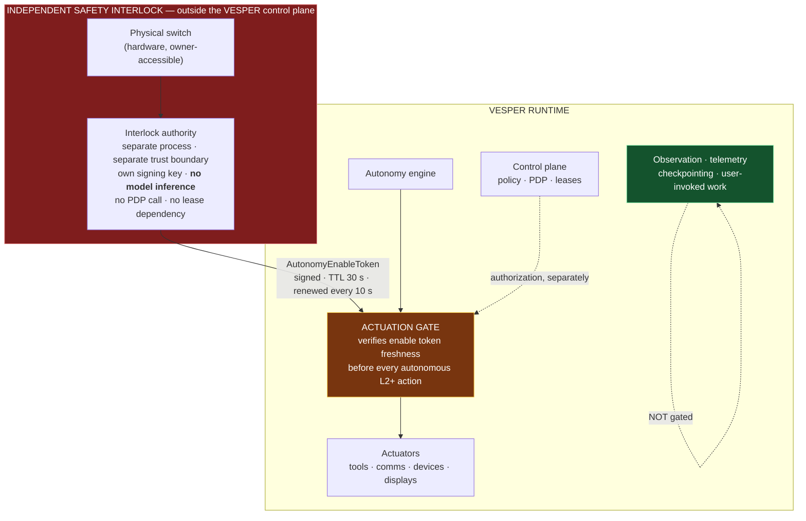

# REM-005 — Independent human emergency stop (safety interlock)

| | |
|---|---|
| **Closes** | FV-01 (P1) — *"No out-of-band human stop"* |
| **Control pair** | REM-004 (NV-01). Neither is credible alone. |
| **Decision record** | **This specification.** The former `ADR-019` citation named an ID outside the Foundation namespace; see `docs/ADR/ADR-REGISTER.md §2`. |
| **Owner** | Security Engineer · **hardware selection: Project Owner** |
| **Blocked by** | REM-002 (what "autonomous actuation" is scoped to) |
| **Blocks** | Nothing — but it **must be specified before the autonomy engine acquires actuation authority**. It is the control you cannot add during the incident it exists for. |

---

## 1. Problem

RB-030 is the entire override provision in the corpus:

> *"Authorized human commands can stop, pause, reconfigure, or inspect Vesper **within the security model**."*

That qualifier is **circular in exactly the scenario that matters**. If the control plane is wedged, partitioned, or is itself the fault, an override that runs *through* the control plane runs through the component that failed.

Machine check against the COC text: `emergency`, `shutdown` and `kill` appear **zero times**. `stop condition` appears only in RB-035 and IC-008, as a property of *tasks* — not a human-facing control. **There is no acceptance test for override anywhere in `A-001`…`A-020`.** The Foundation asks *"Can it stop autonomous work?"* as a final audit **question**, with no mechanism behind it.

**Why this is real and not manufactured.** It is the backstop that makes REM-004 credible. If the runtime's self-write boundary is enforced by the policy layer, and the compromise scenario targets the policy layer, then an override that also runs through that layer **is not an independent control**. REM-004 and REM-005 are one control pair.

## 2. Authoritative requirement

| Source | Text |
|---|---|
| **RB-030** | *"Authorized human commands can stop, pause, reconfigure, or inspect Vesper within the security model."* |
| **P-010** | *"Self-protection means system integrity, not self-preservation against the owner… remaining **subordinate to authorized human control**."* |
| **RB-031** | *"User safety, system integrity, legal/authorization boundaries, and data integrity outrank task completion."* |
| **RB-035** | *"Autonomous work must have checkpointing, resource limits, and a recovery/stop condition."* |
| **DR-023** | *"The user should be able to inspect/control Vesper through an interface **without needing to use the same interface Vesper uses for its own operation**."* |
| **DR-027** | Incident containment: isolation, evidence preservation, rollback, recovery |
| **T-007** | Autonomous runaway |

> **DR-023 already contains the principle.** It requires a control path that is not the system's own operating path. FV-01 is the observation that DR-023 was never discharged for the *stop* case.

## 3. Affected subsystems

`SPEC-23 Unattended operation` · `SPEC-12 Autonomy` · `SPEC-21 Security` · action plane (every actuator) · `SPEC-25 Observability` · `SPEC-19 Hardware abstraction`.

## 4. Required behaviour

### 4.1 The mechanism choice, and why

FV-01's second required test case is: **sever the stop path itself — assert autonomy halts.** That requirement determines the mechanism.

| Design | Behaviour when the stop path is severed | Verdict |
|---|---|---|
| **Kill signal** (human sends "stop") | Autonomy **continues** — the message cannot be delivered | **Fails by construction.** Rejected. |
| **Heartbeat from control plane** | Depends on the component being protected against | Rejected — not independent |
| **Positive enable token, continuously renewed by an independent interlock** (dead-man's switch) | Tokens stop arriving; autonomy **halts** | **ACCEPTED** |

> **The system is not stopped by an act. It is permitted to run by a continuously renewed act.** Absence of permission is the safe state, so every failure of the control path — severed, wedged, compromised, powered off — halts autonomy rather than releasing it.

### 4.2 Architecture



### 4.3 The enable token

```
AutonomyEnableToken {
  token_id
  scope        : AUTONOMOUS_ACTUATION | ALARM_ACTUATION
  issued_at_wall
  valid_until          # issued_at + TOKEN_TTL (default 30 s)
  interlock_id
  signature            # interlock's key — NOT in the runtime secret store
}
```

- Renewed every `TOKEN_RENEW_INTERVAL` (default 10 s), so two consecutive renewal failures still leave margin before expiry.
- The actuation gate verifies signature **and** freshness before **every** autonomous action at `L2` or above. Not per-session, not per-task — **per action**.
- The runtime **cannot mint, extend, or replay** a token: it does not hold the key, and `token_id` is single-use per actuation-gate epoch.

### 4.4 Two stop positions

Emergency stop must not silently defeat SR-043 (*"I'm a sleeper so he must not stop"*). The control therefore has two positions:

| Position | Trigger | Halts | Preserves |
|---|---|---|---|
| **STOP_AUTONOMY** *(default)* | Single press · CLI · out-of-band channel | All autonomous actuation: tools, external comms, device/display control, ambience, proactive presence | **Alarms**, observation, telemetry, checkpointing, user-invoked interactive work |
| **STOP_ALL** | Press-and-hold ≥ 5 s · explicit `--all` | Everything above **plus alarm actuation** | Observation, telemetry, checkpointing only |

Alarms carry their own `ALARM_ACTUATION`-scoped token, so the two classes are independently revocable. This is the same asymmetry REM-002 §4.5 makes for partitions, and for the same reason: a missed wake-up is a source-requirement violation, so it is stopped only by an unambiguous, deliberate act.

### 4.5 Timing bounds

| Bound | Value | Meaning |
|---|---|---|
| `T_new_action` | **≤ 2 s** | No new autonomous actuation begins after the stop |
| `T_quiesce` | **≤ 30 s** | In-flight actions checkpoint and stop; they **checkpoint rather than corrupt** |
| `T_token_ttl` | 30 s | Worst-case autonomous activity after the interlock dies |
| `T_report` | ≤ 5 s | Stop event is audited and surfaced on every available surface |

In-flight work enters `RESUMABLE` (REM-002 §4.6) — **not** `FAILED`. The stop is a pause of authority, not a destruction of state; otherwise the owner would be penalised for using it, and a control the owner avoids using is not a control.

### 4.6 Re-arm

Re-arming requires a **human physical or authenticated out-of-band act**. It is never automatic and never time-based. A stop that expires on its own is defeated by waiting, and waiting is precisely what an autonomous system does well.

Re-arm emits `safety.interlock_rearmed` with the human principal, and the autonomy engine restarts from checkpoints rather than from plan start.

### 4.7 Independence requirements (normative)

The interlock is only a control if it is genuinely independent. All six are mandatory:

1. **Separate process and trust boundary** from the VESPER control plane. Preferably a separate node; separate process always.
2. **No dependency on the PDP, on any lease, or on the world model.** The interlock does not ask permission to stop.
3. **No model inference in its decision path.** No LLM decides whether the stop applies.
4. **Its signing key is not in the runtime's secret store** and is not readable by any runtime capability.
5. **Its code, configuration and hardware path are `GOVERNED_PATHS` surface 8** (REM-004 §4.2). The runtime may propose changes; it may never apply them.
6. **Its own health is externally observable** — the interlock reports to the owner, not through VESPER's presence layer, so a wedged VESPER cannot mask a dead interlock.

## 5. Ownership and authority

| Concern | Owner | Authority |
|---|---|---|
| Interlock protocol, token schema, actuation gate | Security Engineer | `E2`/`E3`; owner sign-off (security boundary) |
| Physical switch hardware selection & placement | **Project Owner** | Recorded in `docs/runbooks/RUNBOOK-EMERGENCY-STOP.md` |
| Timing bounds | Security Engineer proposes; **Project Owner ratifies** | Configuration under owner-only control |
| Invoking the stop | **Any authenticated human with physical access.** Deliberately low-friction — a stop that is hard to invoke is not a stop. | — |
| Re-arm | Human only | Never automatable |

## 6. Interfaces

| Interface | Change |
|---|---|
| `IC-008` Autonomy | Every autonomous action declares `actuation_scope ∈ {AUTONOMOUS_ACTUATION, ALARM_ACTUATION}` |
| `IC-003` Tool | Invocation path traverses the actuation gate when `subject.kind == runtime` and the action is autonomous |
| `IC-009` Security | `safety.stop_engaged` / `safety.stop_scope` / `safety.interlock_rearmed` / `safety.token_stale` audit events |
| New | `contracts/policy/autonomy_enable_token.schema.json` |

## 7. Invariants

| ID | Statement |
|---|---|
| **INV-STOP-1** | Autonomous actuation at `L2`+ requires a **fresh, valid enable token**. Absence of a token halts actuation. The safe state is "not permitted". |
| **INV-STOP-2** | The stop path does not traverse the VESPER control plane, the PDP, any lease, or any model inference. |
| **INV-STOP-3** | Severing, wedging, powering off, or compromising the interlock **halts** autonomy within `T_token_ttl`. Fail-safe, not fail-open. |
| **INV-STOP-4** | The runtime cannot mint, extend, replay, or forge an enable token; the signing key is not reachable by any runtime capability. |
| **INV-STOP-5** | Stop halts autonomous actuation only. Observation, telemetry, checkpointing and user-invoked interactive work continue. |
| **INV-STOP-6** | In-flight actions checkpoint to `RESUMABLE`; they are never left partially applied or marked `FAILED`. |
| **INV-STOP-7** | Re-arm requires a human act. There is no time-based, automatic, or self-service re-arm. |

## 8. Failure behaviour

| Failure | Behaviour |
|---|---|
| Interlock process dies | Tokens stop; autonomy halts within 30 s; `safety.token_stale` emitted; owner notified out-of-band |
| Network to interlock severed | Same. **This is the FV-01 test case and it must halt.** |
| Interlock issues tokens but the switch is broken open (stuck ON) | Detected by the interlock's own self-test and by the owner-facing health report; the interlock refuses to issue tokens when its switch state is indeterminate |
| Clock skew makes tokens appear expired | Autonomy halts. Over-restriction is recoverable (the owner re-arms); under-restriction is not. |
| Runtime replays an old token | Rejected — `token_id` is single-use per gate epoch |
| Control plane wedged, interlock healthy | Stop **still works** — that is the entire point. Autonomy halts even though the control plane cannot process anything. |
| Actuation gate bypassed by a code path | `CI-018` structural check fails the build; this is the failure mode the CI check exists for |

## 9. Recovery

`STOP → assess → restore known-good if needed (REM-004 §9) → human re-arm → resume from checkpoint`. Nothing in the stop path destroys state, so recovery is resumption, not reconstruction. The runbook `docs/runbooks/RUNBOOK-EMERGENCY-STOP.md` is a **required deliverable** of this REM, because a control whose invocation procedure is undocumented is a control that will not be invoked correctly at 03:00.

## 10. Contract / state machine / decision function

| Artifact | ID / path |
|---|---|
| Enable token schema | `contracts/policy/autonomy_enable_token.schema.json` |
| Interlock state machine | `SM-INTERLOCK` (`ARMED → STOP_AUTONOMY → STOP_ALL → ARMED`, re-arm human-gated) |
| Actuation admission | `DF-ACTUATION-GATE` |

## 11. Verification

**`A-031` — Independent emergency stop.**

| Case | Injection | Assertion |
|---|---|---|
| 31.1 | **Wedge the control plane**, then invoke the stop | All autonomous actuation ceases within `T_new_action`; in-flight work checkpoints to `RESUMABLE`; event audited |
| 31.2 | **Sever the stop path itself** (kill interlock / cut its network) | **Autonomy halts within `T_token_ttl`.** Fail-safe direction proven. |
| 31.3 | Simulate a compromised policy plane that grants everything | Stop still halts actuation — independence proven |
| 31.4 | Engage `STOP_AUTONOMY` | Observation, telemetry, checkpointing, user-invoked work and **alarms** all continue |
| 31.5 | Engage `STOP_ALL` | Alarms also halt; observation and telemetry continue |
| 31.6 | Runtime attempts to mint / extend / replay a token | Refused; key unreachable; `safety` audit event |
| 31.7 | Runtime attempts to modify interlock configuration | Refused — `GOVERNED_PATHS` surface 8 (REM-004) |
| 31.8 | Wait 24 h after a stop with no human action | System remains stopped. **No automatic re-arm.** |
| 31.9 | Human re-arms | Autonomy resumes **from checkpoint**, not from plan start; `safety.interlock_rearmed` names the human principal |

**Negative control.** 31.2 must be shown **FAILING** against a kill-signal implementation (option 1 in §4.1). That red run is the evidence that the dead-man's-switch choice was necessary rather than stylistic.

## 12. CI enforcement

| Check | Enforces |
|---|---|
| `CI-018` `actuation-gate-completeness` | `INV-STOP-1` — structural: **every** autonomous actuation path reaches an actuator only through `DF-ACTUATION-GATE`. Reachability analysis from the autonomy engine to every actuator adapter. |
| `CI-019` `interlock-independence` | `INV-STOP-2` — static: the interlock module imports nothing from `core/`, `policy/`, `models/`, or the world model |
| `CI-015` `no-runtime-governed-write` | Surface 8 protection (REM-004) |

## 13. Dependencies

**Requires:** REM-002 (`RESUMABLE`, checkpoints), REM-004 (surface 8 protection — and REM-004 requires this in return; they are ratified together). **Required by:** REM-007 and REM-008 — the autonomy engine may not acquire actuation authority before this contract exists.

## 14. Unresolved decisions

| # | Item | Disposition |
|---|---|---|
| 1 | Physical switch hardware and placement | **Project Owner.** Engineering requires only: owner-reachable without unlocking a computer, and its open/closed state readable by the interlock. |
| 2 | Whether the interlock runs on a dedicated device or a separate process on an existing node | Engineering recommends a **dedicated low-power device** (the Raspberry Pi already contemplated for SR-037 is a candidate). A separate process is the acceptable minimum; a separate device is the correct answer. |
| 3 | Out-of-band invocation channel besides the physical switch | Recommended: a direct authenticated path to the interlock that does not traverse VESPER (e.g. its own minimal listener). Must not depend on VESPER's presence layer. |
| 4 | Timing bound values | Proposed in §4.5; owner ratifies. |

## 15. Jarvis-divergence check

> *Could an implementation agent satisfy REM-005 while building an ordinary chatbot?*

**Not applicable in the usual direction — but the degenerate implementation is real and must be excluded.** The degenerate version is "an `is_stopped` boolean the runtime checks", which is a kill signal wearing a costume: it is stored in the system being stopped, and it fails `A-031.2` and `A-031.3`. The clause that prevents it: **`INV-STOP-1` — actuation requires a *fresh externally-signed token*, so the permissive state cannot be produced by the runtime at all**, only by something outside it that the owner physically controls.
