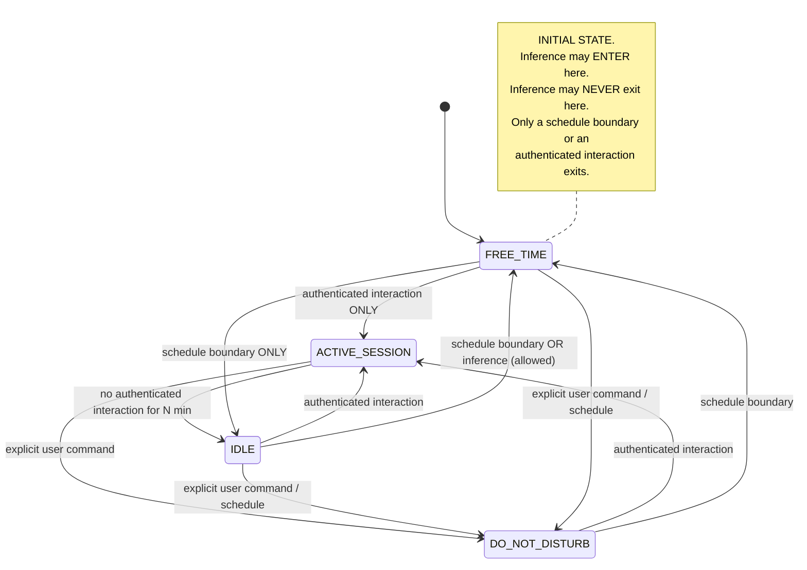

# REM-006 — `OperatingPeriod` state machine and cost-class enforcement

| | |
|---|---|
| **Closes** | AR-004 (P0) · AR-005 (P0) · AR-033 (P2) · GAP-038, GAP-039 |
| **Decision record** | **This specification.** The former `ADR-020` citation named an ID outside the Foundation namespace; see `docs/ADR/ADR-REGISTER.md §2`. |
| **Owner** | Intelligence Systems Engineer (gateway) · Autonomy & Task Engineer (period evaluator) |
| **Blocked by** | REM-001 (period is evaluated over time-stamped facts), REM-003 (same choke point) |
| **Blocks** | REM-007, REM-008 — trigger eligibility consumes `OperatingPeriod` |

---

## 1. Problem

**Two defects that meet at the model gateway.**

**(a) An absolute prohibition is keyed to an explicitly untrusted inference.** SR-045 defines free-time by **user state**: *"when I'm sleeping, when I'm not home, when he's on a break"*. RB-016/RB-017 make the consequence **absolute**: paid API usage is *"prohibited… regardless of convenience"*. But COC ARCH-16 declares user state *"evidence, not facts about the user"*, and DR-011 requires confidence and expiry on it. So an absolute rule is gated on a probabilistic input **with no defined fail-direction**. Both error directions violate a stated absolute: infer "awake" wrongly and paid calls happen during free-time; infer "asleep" wrongly and legitimate daytime work is blocked.

**(b) The fallback ladder routes to paid by design.** COC ARCH-24, verbatim:

> *"Provider failure: classify → retry/backoff → **alternate provider/model** → local fallback → escalation."*

"Alternate provider" precedes "local fallback" **with no cost gate**. During free-time, free-tier exhaustion therefore escalates onto a paid provider *by design*, contradicting RB-017. This is not a bug an implementation might introduce — it is what the specification instructs.

**(c) No cost policy artifact exists.** RB-017 permits paid usage *"only when an explicit cost policy authorizes it"*. With no artifact, the correct default is **deny** — so the current exposure is smaller than "unbounded burn" suggests, but the artifact is still required before any paid call is legitimate.

## 2. Authoritative requirement

| Source | Text |
|---|---|
| **SR-045** | *"All free-time (when I'm sleeping, when I'm not home, when he's on a break, when we're not working on something) activities should be run on free models only, no API-calls."* |
| **RB-016** | *"Free-time/overnight autonomous work uses free/local models only… if no eligible free/local path exists, Vesper queues, pauses, degrades, or stops the work."* |
| **RB-017** | *"Never incur paid API cost during source-defined free-time… Outside those periods, paid usage is allowed only when an explicit cost policy authorizes it."* |
| **DR-013** | *"Paid APIs are prohibited during source-defined free-time periods, regardless of convenience."* |
| **SR-003** | *"switches API when quota or error shows up automatically… retry without stopping"* |
| **ARCH-16** | *"State estimates are evidence, not facts about the user."* |
| **DR-011** | Confidence, provenance, expiration on inferred state |
| **T-014** | Cost leakage |

**The SR-003 × SR-045 tension is resolved, not weakened.** During `FREE_TIME`, SR-003's *"retry without stopping"* is satisfied by continuing **within the free/local subset**, and by **queueing rather than terminating** when that subset is exhausted. Both SRs stand unmodified. This resolution is recorded **here**, in §4 and §7, and requires no COC change. *(Corrected 2026-08-12: this sentence previously cited a decision record at an ADR id outside the Foundation namespace, which had never been filed. See `docs/ADR/ADR-REGISTER.md §2`.)*

## 3. Affected subsystems

`SPEC-10 Model gateway` · `SPEC-11 Model routing` · `SPEC-12 Autonomy` · `SPEC-13 Trigger evaluation` · `SPEC-02 Core control loop` (period evaluator) · `SPEC-26 Configuration`.

## 4. Required behaviour

### 4.1 `OperatingPeriod`



**Transition drivers — exhaustive:**

1. User-configured schedule
2. Explicit user command
3. **Ground-truth session activity** = an *authenticated* interaction within the last `N` minutes

> **Mood, physiology, presence and camera inference are NOT transition drivers.** They are inputs to the *entry* asymmetry below, and to nothing else.

### 4.2 The fail-closed asymmetry — the invariant

```
Inference MAY cause ENTRY into FREE_TIME.
Inference MAY NEVER cause EXIT from FREE_TIME.
Only a schedule boundary or an authenticated user interaction exits it.
```

**Rationale, stated so it is not re-litigated:** over-restriction is recoverable — the user speaks, and the period exits within one cycle. Under-restriction is not — money is already spent. Where an absolute rule rests on a probabilistic input, the asymmetry must fall toward the recoverable error.

**`FREE_TIME` is the initial state** on cold start, after a crash, after a partition, and whenever the period is indeterminate. `clock_suspect` (REM-001 §4.1) forces `FREE_TIME` regardless of schedule, because a schedule evaluated against an untrusted clock is not a schedule.

### 4.3 Cost class

```
cost_class ∈ { free, metered_free_tier, paid }
```

- **Mandatory and non-nullable** on every credential and every model profile, resolved **at registration**. A credential with no `cost_class` cannot be registered.
- **`metered_free_tier` is treated as `paid`** unless a *provable hard spend cap* exists. A free tier on an account with a payment method attached can bill on overage; without a provable cap, the absolute rule leaks. (Hidden assumption #2 in the gap register, now closed.)

### 4.4 The filtered fallback ladder

Replaces the unfiltered ARCH-24 ladder. This is a **clarification of implementation obligation**, not a change to ARCH-24's requirement — the ladder's steps are unchanged; a filter is added to one step, and the terminal step is made explicit.

```
classify
  → retry / backoff
  → alternate provider/model     [SKIP if cost_class not permitted by policy for the current OperatingPeriod]
  → local fallback
  → queue / pause / degrade / stop          (NOT escalate-to-paid)
```

> **Enforcement lives at a SINGLE choke point inside the model gateway. No caller may reach a provider adapter without traversing it.** This is a structural requirement, verified by `CI-020`, not a code-review convention.

### 4.5 On exhaustion under a restrictive policy

```
emit autonomy.blocked_on_cost_policy
checkpoint the task
queue for the next permitted period
DO NOT wake the user for ordinary work            # SR-042
DO NOT escalate to a paid provider                # RB-017
```

### 4.6 Cost policy artifact

`contracts/policy/cost_policy.toml`, owner-only change control, **explicitly not learnable** (`INV-LEARN-1`, REM-011):

| Field | Meaning |
|---|---|
| `permitted_cost_classes[period]` | Per `OperatingPeriod`. `FREE_TIME` ⇒ `["free"]` only — and this entry is not editable to include `paid`; `CI-021` rejects such a diff. |
| `per_task_ceiling`, `per_day_ceiling` | Hard stops |
| `alert_threshold` | Fraction of ceiling at which the owner is notified |
| `mid_task_escalation_path` | What happens when a running task would cross the ceiling: **queue and ask**, never auto-approve |

> **The gateway fails closed when no cost policy is loaded.** No policy ⇒ no paid class permitted ⇒ free/local only. This makes the *absence* of the artifact safe, which is why AR-033 is P2 rather than P0.

## 5. Ownership and authority

| Concern | Owner | Authority |
|---|---|---|
| `OperatingPeriod` evaluator | Autonomy & Task Engineer | `E2`/`E3` |
| Cost-class resolution & choke point | Intelligence Systems Engineer | `E2`/`E3` |
| `cost_policy.toml` values (ceilings, thresholds) | **Project Owner** | Owner-only; governed surface 1 (REM-004) |
| The fail-closed asymmetry itself | Architecture Steward | Changing it requires a new ADR **and** owner approval — it is the mechanism that makes an absolute source rule hold |

## 6. Interfaces

| Interface | Change |
|---|---|
| `IC-002` Model Provider | Adds mandatory `cost_class`; adds `quota_state` with rolling-window local tracking (free tiers rarely expose introspection) |
| `IC-008` Autonomy | Adds `cost_policy` reference; `autonomy.blocked_on_cost_policy` event |
| `IC-001` Event | `operating_period.changed` carries `from`, `to`, `driver`, `evidence_ref` — RB-019 explainability |

Contracts: `contracts/policy/cost_policy.toml`, `contracts/entities/model_profile.schema.json`.

## 7. Invariants

| ID | Statement |
|---|---|
| **INV-COST-1** | Zero paid-provider requests may leave the gateway while `OperatingPeriod = FREE_TIME`, under any inference input. |
| **INV-COST-2** | Inference may enter `FREE_TIME`; it may never exit it. Only a schedule boundary or an authenticated interaction exits. |
| **INV-COST-3** | No code path reaches a provider adapter without traversing the cost-class choke point. |
| **INV-COST-4** | `cost_class` is non-nullable on every credential and model profile, resolved at registration. |
| **INV-COST-5** | `metered_free_tier` is treated as `paid` absent a provable hard cap. |
| **INV-COST-6** | Gateway with no loaded cost policy permits `free` only. |
| **INV-COST-7** | Indeterminate period, or `clock_suspect`, ⇒ `FREE_TIME`. |

## 8. Failure behaviour

| Failure | Behaviour |
|---|---|
| All free providers exhausted during `FREE_TIME` | `autonomy.blocked_on_cost_policy`; checkpoint; queue. **Zero paid attempts, asserted at the gateway, not inferred from logs.** User is not woken. |
| Period evaluator unavailable | `FREE_TIME` (`INV-COST-7`) |
| Inference says "user is awake" during `FREE_TIME` | **Ignored** for the exit decision. Recorded as evidence; does not transition. |
| User speaks during `FREE_TIME` | Authenticated interaction ⇒ exits to `ACTIVE_SESSION` within one cycle |
| Credential registered with no `cost_class` | Registration refused; startup fails loudly |
| Ceiling reached mid-task | Task → `WAITING`; owner asked; never auto-approved |
| Clock regression | `clock_suspect` ⇒ `FREE_TIME` until re-anchored |

## 9. Recovery

Blocked work is **queued, not lost**. On the next permitted period the queue drains from checkpoints (REM-002 §4.7). This is what makes the absolute rule tolerable in practice: the cost of over-restriction is latency, not lost work.

## 10. Contract / state machine / decision function

| Artifact | ID / path |
|---|---|
| Cost policy | `contracts/policy/cost_policy.toml` |
| Model profile (with `cost_class`) | `contracts/entities/model_profile.schema.json` |
| Period state machine | `SM-OPERATING-PERIOD` |
| Period evaluator | `DF-OPERATING-PERIOD` |
| Provider admission | `DF-PROVIDER-ADMIT` |

## 11. Verification

**`A-021` — Operating period and cost class.**

| Case | Injection | Assertion |
|---|---|---|
| 21.1 | Adversarial inference: "user is awake" (high confidence) during `FREE_TIME` | No transition; no paid call; evidence recorded |
| 21.2 | Adversarial inference: "user is asleep" during `ACTIVE_SESSION` | May enter `FREE_TIME` — the permitted direction |
| 21.3 | Authenticated interaction during `FREE_TIME` | Exits within one evaluation cycle |
| 21.4 | Query current period and its cause at any time | Both always retrievable (RB-019) |
| 21.5 | Cold start / post-crash / post-partition | Period is `FREE_TIME` |
| 21.6 | Regress the clock | `clock_suspect` ⇒ `FREE_TIME` |
| 21.7 | Register a credential with no `cost_class` | Refused |
| 21.8 | `metered_free_tier` credential with no provable cap during `FREE_TIME` | Treated as `paid`; not used |

**`A-004` extended — provider fallback under cost policy.** Revoke *all* free providers mid-task during `FREE_TIME`:
- assert **zero paid attempts at the gateway boundary** (an assertion on the gateway, not an inspection of logs);
- assert checkpointed pause and `autonomy.blocked_on_cost_policy`;
- assert the user is **not** woken.

**Negative control.** `A-021.1` and the extended `A-004` must be shown **FAILING** against a build implementing the unfiltered ARCH-24 ladder. That red run is the proof that AR-005 was a real defect and not a reading.

## 12. CI enforcement

| Check | Enforces |
|---|---|
| `CI-020` `gateway-choke-point` | `INV-COST-3` — structural: every provider-adapter call site is reachable only through `DF-PROVIDER-ADMIT` |
| `CI-021` `cost-policy-freetime-immutable` | `INV-COST-1` — a diff that adds any non-`free` class to `permitted_cost_classes[FREE_TIME]` fails, regardless of reviewer |
| `CI-022` `cost-class-nonnull` | `INV-COST-4` — every model profile and credential fixture declares `cost_class` |

## 13. Dependencies

**Requires:** REM-001 (`clock_suspect`, TTL'd presence facts), REM-003 (same choke-point discipline). **Required by:** REM-007 (trigger `cost_policy` field), REM-008 (endurance run executes entirely in `FREE_TIME`), REM-011 (cost policy is a non-learnable surface).

## 14. Unresolved decisions

| # | Item | Disposition |
|---|---|---|
| 1 | `N` minutes for session-activity ground truth | Owner configuration. Proposed 15 min. |
| 2 | Ceilings and alert thresholds | **Project Owner sets the numbers.** Engineering sets the rule that they exist and are enforced. |
| 3 | What counts as a "provable hard cap" per provider | Per-provider research item; until proven, `metered_free_tier` = `paid`. Fail-direction is already safe. |

## 15. Jarvis-divergence check

> *Could an implementation agent satisfy REM-006 while building an ordinary chatbot?*

**Partly — and the residue is closed elsewhere.** A chatbot could implement a cost gate. But the clause that does not fit a chatbot is **§4.1: `OperatingPeriod` is control-plane state that exists and transitions when no user is present**, driven by schedule and authenticated-activity ground truth rather than by request context. A request-scoped system has no state to be in between requests. `A-021.5` (period is `FREE_TIME` after a crash, with no user) has no meaning in a chatbot and cannot be satisfied by one.
