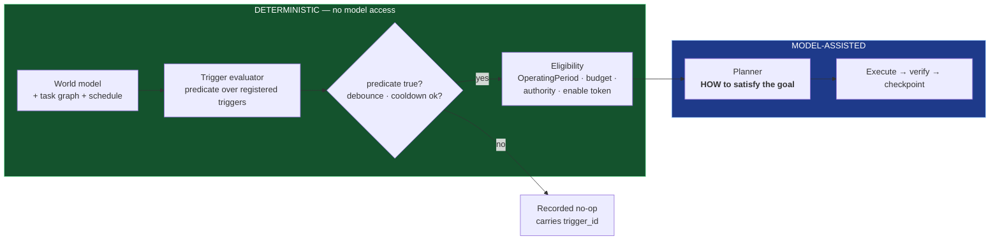

# REM-007 — `Trigger` registry, predicate language, and `InterruptionBudget`

| | |
|---|---|
| **Closes** | AR-008 (P0) · AR-025 (P1) · GAP-019, GAP-045 |
| **Decision record** | **This specification** discharges Foundation **ADR-009** (autonomous scheduler); no separate filing. See `docs/ADR/ADR-REGISTER.md`. |
| **Owner** | Autonomy & Task Engineer |
| **Blocked by** | REM-001 (predicates evaluate over world facts), REM-002 (`autonomy_queue` is leased), REM-006 (eligibility consumes `OperatingPeriod`) |
| **Blocks** | REM-008 — the registry is what makes the zero-input gate testable |

---

## 1. Problem

**The autonomy model is forbidden by negation and undefined by omission.**

| Constraint | Source |
|---|---|
| *"Do not reduce autonomy to a cron job that runs isolated scripts."* | COC ARCH-28 |
| *"Proactivity is generated by this loop, not by repeatedly asking an LLM to invent tasks."* | COC ARCH-04 |

Those are the only two implementable options in the absence of a specification, and **both are prohibited**. No third is specified, and Foundation ADR-009 is filed unresolved. An implementer facing this either picks a forbidden option or invents architecture.

Separately, **RB-005 and RB-006 point in opposite directions with no arbitration metric**:

- RB-005: *"Do not wait for a user message when a permitted useful action can be prepared or executed safely."*
- RB-006: *"Do not act merely because action is possible. Act when the expected benefit justifies cost, risk, interruption, and resource use."*

Nothing tells an implementation how to decide. The natural resolution — ask the model — reintroduces the forbidden option.

## 2. Authoritative requirement

| Source | Text |
|---|---|
| **DR-005** | *"**Continuously evaluate** active tasks, schedules, environment state, user availability, and permitted background work; initiate only policy-authorized actions."* |
| **ARCH-04** | *"Primary continuous control loop: observe → normalize → update world model → evaluate goals/tasks → **choose action or no-action** → authorize → execute → verify → update state → learn."* · *"Silence/no-op is an explicit decision."* |
| **RB-005 / RB-006** | Initiative / proportionality |
| **RB-018** | *"Autonomous execution is allowed only inside a defined goal, tool, resource, time, and authorization scope."* |
| **RB-019** | *"For consequential or surprising actions, retain and expose trigger, authority, chosen method, device/model, and outcome."* |
| **RB-035** | *"Autonomous work must have checkpointing, resource limits, and a recovery/stop condition."* |
| **SR-036** | *"Take actions when elected → identify → talk or take action."* |
| **SR-042** | Overnight autonomous work; do not wake the user for ordinary work |
| **A-018** | Auditability: reconstruct trigger, authority, model, device, tool, result, verification |

> **RB-019 and A-018 are unsatisfiable without a named trigger.** "Expose the trigger" presupposes that triggers are first-class objects with identity. That, and not safety alone, is why the registry is architecture rather than implementation detail.

## 3. Affected subsystems

`SPEC-12 Autonomy` · `SPEC-13 Trigger evaluation` · `SPEC-14 Attention and interruption` · `SPEC-02 Core control loop` · `SPEC-06 World model` (predicate domain) · `SPEC-16 Presence` (interruption cost).

## 4. Required behaviour

### 4.1 The third option

The forbidden pair is a false dichotomy, and the escape is a **separation of concerns in time**:

> **A deterministic predicate over world-model state decides *whether* a goal exists. A model decides *how* to satisfy a goal that is already justified. The model never decides whether to act.**

That is neither cron (the predicate is over *state*, not over *time*) nor LLM-invented tasks (the model is downstream of the decision, not upstream of it).



### 4.2 `Trigger`

```
Trigger {
  trigger_id, name, owner, enabled,
  predicate,                 # declarative expression over world-model facts,
                             # task-graph state, schedule, and event patterns
  predicate_class,           # SCHEDULE | STATE | EVENT | COMPOSITE   <-- REM-008 depends on this
  debounce, cooldown, priority,
  required_authority,        # max effective level actions under it may reach
  actuation_scope,           # AUTONOMOUS_ACTUATION | ALARM_ACTUATION  (REM-005)
  resource_budget, cost_policy, stop_conditions, reporting_policy,
  provenance                 # authored | promoted-from-proposal
}
```

### 4.3 The predicate language

Deliberately **not** a general-purpose language. It is a total, side-effect-free, terminating expression language over four typed domains:

| Domain | Accessors |
|---|---|
| World facts | `world.<subject>.<attribute>` → value \| `UNKNOWN` \| `CONFLICTED` |
| Task graph | `task.<id>.state`, `tasks.count(state)`, `task.<id>.age` |
| Schedule | `schedule.now_in(window)`, `schedule.elapsed_since(marker)` |
| Event patterns | `events.seen(type, within)`, `events.count(type, within)` |

Operators: comparison, boolean, `is_unknown()`, `is_conflicted()`, `changed_since(hlc)`, `stale_for(duration)`.

**Three rules that make it safe:**

1. **`UNKNOWN` is not falsy.** Any comparison against `UNKNOWN` evaluates to `UNKNOWN`, and a predicate evaluating to `UNKNOWN` **does not fire**. This is RB-002 enforced in the language: a trigger cannot fire on a fact the system does not have. (`CONFLICTED` behaves the same way.)
2. **No model calls, no I/O, no unbounded loops.** The evaluator runs in a context where model access is *denied and the denial is observable* (§4.4).
3. **Total and terminating.** Every predicate is statically checkable for termination; a predicate that cannot be proven terminating is rejected at registration.

**Evaluation is a deterministic pass over the registry** on every control-loop tick and on every world-model change to a subject any predicate references. The change-driven path is what makes it responsive rather than polled — and it is what REM-008 tests.

### 4.4 Model-denial in the decision path (mechanically detectable)

> **INV-TRIG-2 must be *observable*, not merely asserted.** The trigger evaluator executes inside an **evaluation sandbox** whose capability set contains **no model capability at all**. An attempt to invoke a model from inside it does not merely fail — it emits `autonomy.model_call_in_decision_path` and raises.

This matters because REM-008's anti-cron gate asserts "no model call in the decision path". An assertion that cannot be observed is not a test. The sandbox turns the property into a runtime-detectable event and a CI-checkable capability set.

### 4.5 Standing goals and proposed triggers

- **Standing goals** are represented as long-lived triggers with re-evaluation conditions — **not** as recurring prompts. "Keep the research library indexed" is a `STATE` predicate over index freshness, not a nightly prompt.
- **A model may PROPOSE a trigger. It may not BE one.** Proposals enter the registry only through the REM-011 promotion gate, which requires a held-out regression pass and — because `autonomy/triggers/` is `GOVERNED_PATHS` surface 7 (REM-004) — a human merge for authored-equivalent entries.

### 4.6 `InterruptionBudget` — arbitrating RB-005 against RB-006

> **The distinction that resolves most of the tension: RB-005's "prepared or executed safely" licenses UNLIMITED preparation. Preparation is free and is the default. Interruption is strictly budgeted.**

```
InterruptionBudget {
  per (OperatingPeriod, user_attention_state):
    max_proactive_contacts_per_hour
    modality_cost: { ambient_visual: low, visual_notice: medium,
                     speech: high, alarm: EXEMPT }
}
```

**The proactive decision function** — deterministic, not a model judgement:

```
Every proactive action declares (expected_value, decays: bool, interruption_cost, reversibility).

act_now  ⇔  expected_value > interruption_cost  ∧  decays
otherwise → QUEUE for the next natural interaction boundary
```

`decays` is the load-bearing term. Information that is still useful in two hours does not justify an interruption now; information that expires does. High-value non-decaying items are **queued, never dropped** — dropping them would violate RB-005.

**Alarm class is exempt** from the budget, and from RB-034 ambience policy, RB-015 resource yielding, RB-006 proportionality, and device quiet-hours. The priority lattice (REM-011) states this:

```
alarm/safety  >  active user task  >  ambience  >  proactive
```

## 5. Ownership and authority

| Concern | Owner | Authority |
|---|---|---|
| Trigger schema, predicate language, evaluator | Autonomy & Task Engineer | `E2`/`E3` |
| Evaluation sandbox capability set | Security Engineer | `E2`; owner sign-off (it enforces a security-relevant property) |
| Authored trigger entries | Project Owner / subsystem owners | `autonomy/triggers/` is governed surface 7; human merge |
| Promoted triggers | Promotion gate (REM-011) + human merge | Runtime holds `E1` |
| Interruption budget values | **Project Owner** | Configuration |

## 6. Interfaces

| Interface | Change |
|---|---|
| `IC-008` Autonomy | `trigger` becomes a `trigger_id` reference into the registry, not free text. Adds `predicate_class`, `actuation_scope`. |
| `IC-001` Event | `autonomy.trigger_fired`, `autonomy.noop_recorded`, `autonomy.model_call_in_decision_path` |
| `IC-005` Presence | Adds `interruption_cost` and `attention_cost` so the presence layer can price an interruption |

Contracts: `contracts/entities/trigger.schema.json`, `contracts/policy/interruption_budget.toml`.

## 7. Invariants

| ID | Statement |
|---|---|
| **INV-TRIG-1** | Every autonomous action traces to exactly one registered `trigger_id` whose predicate demonstrably evaluated true against a **reconstructible world-model snapshot**. |
| **INV-TRIG-2** | No autonomous action originates from a model call not preceded by a trigger. The evaluator holds no model capability, and an attempt is emitted and raised. |
| **INV-TRIG-3** | Preparation is unbudgeted; interruption is budgeted; alarm class is exempt. |
| **INV-TRIG-4** | A predicate evaluating to `UNKNOWN` or `CONFLICTED` does not fire. |
| **INV-TRIG-5** | Every predicate is total and provably terminating; non-terminating predicates are rejected at registration. |
| **INV-TRIG-6** | A recorded no-op carries a `trigger_id` and is auditable. Silence is a decision with provenance. |
| **INV-TRIG-7** | A model may propose a trigger; a model may not be a trigger. Registry entry requires the promotion gate plus human merge. |

## 8. Failure behaviour

| Failure | Behaviour |
|---|---|
| Predicate references an unknown world subject | Evaluates `UNKNOWN` ⇒ does not fire. Emits `autonomy.predicate_unknown_subject` once per subject per hour. |
| Predicate throws | Trigger disabled, incident recorded, other triggers unaffected — **failure isolation between triggers is mandatory** |
| Evaluator falls behind (loop lag) | `autonomy.evaluator_lag` at threshold; degrade by priority, never by dropping silently |
| Budget exhausted, high-value decaying item | Escalate one modality step **only if** `expected_value` exceeds the escalation cost; otherwise queue and record |
| `autonomy_queue` lease lost | Evaluation continues (read-only); firing suspends; `control.lease_lost` |
| Enable token stale (REM-005) | Actuation halts; the trigger still fires and the action queues — the distinction between *deciding* and *acting* survives the stop |
| Trigger storm (many fire at once) | Priority ordering + per-tick fire cap; overflow queues; `autonomy.fire_cap_reached` emitted rather than silently truncating |

## 9. Recovery

The registry lives in the `autonomy_queue` leased domain and is checkpointed. After failover, the new owner re-evaluates from current world state — **it does not replay missed firings**, because a predicate over current state is self-correcting: if the condition still holds, it fires now; if it no longer holds, firing would have been wrong. Schedule-class triggers whose window elapsed during the outage are reported as missed (`autonomy.window_missed`), never silently skipped.

## 10. Contract / state machine / decision function

| Artifact | ID / path |
|---|---|
| Trigger schema | `contracts/entities/trigger.schema.json` |
| Interruption budget | `contracts/policy/interruption_budget.toml` |
| Trigger lifecycle | `SM-TRIGGER` (`PROPOSED → REVIEWED → ACTIVE → COOLDOWN → ACTIVE` / `DISABLED` / `RETIRED`) |
| Predicate evaluation | `DF-TRIGGER-EVAL` |
| Proactive act-or-queue | `DF-PROACTIVE` |
| Eligibility | `DF-AUTONOMY-ELIGIBLE` |

## 11. Verification

**`A-011` extended — trigger provenance.**

| Case | Assertion |
|---|---|
| 11.1 | 100 % of autonomous actions in a run resolve to exactly one registered `trigger_id` (`INV-TRIG-1`) |
| 11.2 | Each firing's world-model snapshot is reconstructible and the predicate re-evaluates true against it |
| 11.3 | Drive the world model into a firing state; assert the trigger fires **with no model involvement in the decision** |
| 11.4 | Attempt a model call from inside the evaluator | `autonomy.model_call_in_decision_path` emitted and the call raises |
| 11.5 | A predicate over an `UNKNOWN` fact does not fire |
| 11.6 | At least one explicitly recorded no-op carries a `trigger_id` |

**`A-047` — Interruption budget.** N proactive candidates of mixed value/decay:
- budget adherence per period and attention state;
- non-decaying high-value items are **queued, not dropped**;
- queued items surface at the next natural interaction boundary;
- alarm class bypasses the budget and an active quiet-hours policy.

**Negative control.** 11.3 and 11.4 must be shown **FAILING** against a build whose autonomy loop asks a model "is there anything worth doing?" — the ARCH-04-forbidden design. Without that red run there is no evidence the deterministic path is real.

## 12. CI enforcement

| Check | Enforces |
|---|---|
| `CI-023` `evaluator-no-model-capability` | `INV-TRIG-2` — static: the evaluation sandbox's capability set contains no model capability, and the evaluator module imports no model gateway symbol |
| `CI-024` `predicate-totality` | `INV-TRIG-5` — every registered predicate passes the termination checker |
| `CI-025` `action-has-trigger` | `INV-TRIG-1` — structural: no autonomous actuation path constructs an action without a `trigger_id` |

## 13. Dependencies

**Requires:** REM-001 (`UNKNOWN`/`CONFLICTED` as values; reconstructible snapshots), REM-002 (`autonomy_queue` lease), REM-003 (`required_authority`), REM-005 (`actuation_scope`), REM-006 (`OperatingPeriod` eligibility). **Required by:** REM-008 (`predicate_class` is the anti-cron discriminator), REM-011 (promotion gate).

## 14. Unresolved decisions

| # | Item | Disposition |
|---|---|---|
| 1 | Concrete predicate expression syntax | Implementation detail, **constrained** by §4.3's three rules. Any syntax satisfying them is acceptable. |
| 2 | Per-tick fire cap and evaluator tick interval | Configuration; tick interval must be short enough that `STATE` triggers feel responsive (proposed ≤ 1 s) and is separately bounded by the change-driven path |
| 3 | Interruption budget numeric values | **Project Owner** |

## 15. Jarvis-divergence check

> *Could an implementation agent satisfy REM-007 while building an ordinary chatbot?*

**No, and this is one of the three artifacts that carries the anti-chatbot property.** The clause that prevents it: **§4.4 — the trigger evaluator runs in a sandbox with no model capability, and `INV-TRIG-2` is observable.** A chatbot-with-a-scheduler has no deterministic predicate layer; its "decision to act" is a model call by construction, and `A-011.4` detects that directly rather than by inspection. The second clause is **`INV-TRIG-4`**: firing requires a *known* world fact, which presupposes a world model that can be `UNKNOWN` — something a retrieval-over-documents system does not have.
