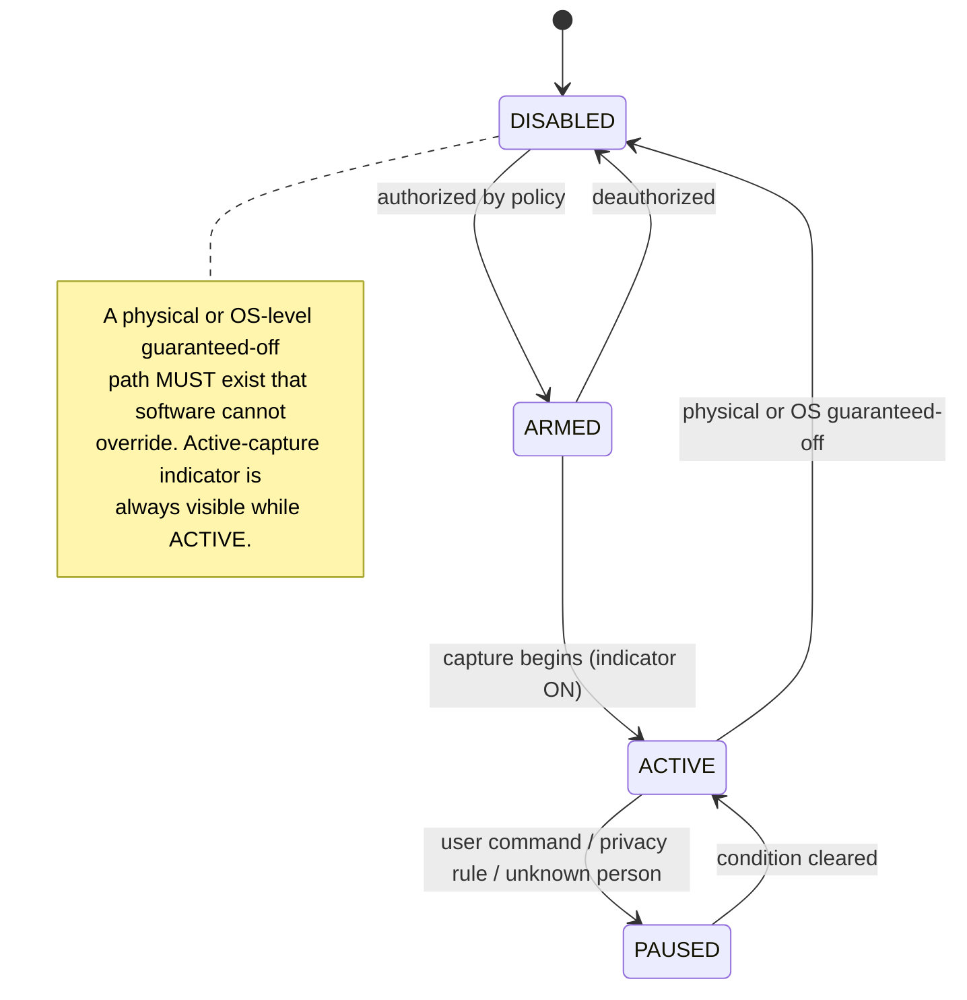

# REM-011 — World-model keying, spatial model, perception privacy, node capability and enrollment

| | |
|---|---|
| **Closes** | AR-017 (P1) · AR-018 (P1) · AR-019 (P1) · AR-027 (P1) · AR-034 (P2) · GAP-016, GAP-020, GAP-021, GAP-037, GAP-042 |
| **Decision records** | **This specification** discharges Foundation **ADR-005** (world-model representation) · `docs/ADR/ADR-007-device-identity-and-trust.md` (**PROPOSED** — owner ratification, `OWNER-DECISION-006`) |
| **Owner** | World & Environment Engineer · Device/Network Engineer · Perception Engineer |
| **Blocked by** | REM-001 (facts, TTL, conflict) |
| **Blocks** | REM-009 (privacy routing, spatial anchoring), REM-008 (`Z2` synthetic observer admission) |

---

## 1. Problem

Four related omissions, all of which surface at the same moment — when a second person walks into the room.

**(a) No entity keying or identity resolution.** SR-029 infers physiology and mood; SR-040 reads handwriting through cameras. Neither says *whose*. There is no `Person` type, no guest concept, and no rule preventing evidence about an unknown person being resolved to the owner.

**(b) No spatial representation.** SR-028 requires displays to *"define their place from network and cameras"*; Baseline 05 §10 routes presence *"by proximity"*. Both are unimplementable without a spatial model, and none is specified.

**(c) No sensor lifecycle, consent model, or retention rule.** Always-on microphones and cameras in a home, with no indicator obligation, no guaranteed-off path, and no per-modality retention. ARCH-16's *"local where practical"* for sensitive inference is a preference, not a boundary.

**(d) Hardware agnosticism is asserted in three documents and implemented in none.** No capability profile exists, so `"MacBook Neo"` ends up in configuration and hardware substitution becomes a migration. Baseline 05 §4 correctly says *"visibility on a LAN does not imply trust"* and never says what **does** — there is no admission gate between `ENROLLED` and `TRUSTED`.

## 2. Authoritative requirement

| Source | Text |
|---|---|
| **DR-003 / ARCH-05** | Structured model of devices, spaces, sensors, displays, topology, user context |
| **DR-011 / ARCH-16** | *"State estimates are evidence, not facts about the user."* Confidence, provenance, expiration. |
| **DR-024** | *"Use network identity, cameras/sensors, explicit configuration, and capability discovery to determine where outputs can appear."* |
| **DR-008** | *"Nodes advertise capabilities, health, location/space, permissions, and current resource state."* |
| **RB-024** | *"Use sensors and sensitive user-state inference only when authorized; minimize retention and exposure."* |
| **SR-028 / SR-029 / SR-040** | Display placement; user-state inference; camera reading of physical artifacts |
| **SR-015 / SR-018 / SR-019 / SR-050** | Node inventory and roles |
| **ARCH-13** | *"On MacBook Neo, prefer models that fit comfortably in unified memory…"* — a product name in normative text |

## 3. Required behaviour

### 3.1 Entity keying and `Person`

```
Person { person_id, role: owner | known | unknown_person, confidence, evidence_refs }
```

Evidence → identity resolution is an **explicit policy** producing `(entity_id, confidence, evidence_refs)`, never an implicit join.

> **INV-WORLD-1 (hard).** An unknown person is **never** silently resolved to the owner. Below the resolution threshold the role is `unknown_person`, and `unknown_person` is not a degraded `owner` — it is a distinct role with its own permissions.

### 3.2 Spatial model — topological, not metric

```
Space   { space_id, name, privacy_class }
Edge    { from_space, to_space }              # adjacency
Located { entity_id, space_id, confidence }   # devices, displays, sensors, persons
```

A **topological room graph**, not metric coordinates. No V0 requirement needs metres: SR-028 needs *which room*, and presence routing needs *which surface is where the user is*. Metric coordinates are an optional future refinement, and adopting them now would import a localisation stack no requirement demands.

### 3.3 Presence routing and the privacy fail-safe

```
select_endpoint(scene.privacy_class, space.privacy_class,
                observed_persons, user_location_confidence)
```

> **FAIL-SAFE:** `user_location_confidence < threshold` **OR** an `unknown_person` present in the target space ⇒ route to the **most private available surface**, or **WITHHOLD**. **Never default to the most public surface.**

The default direction is the whole control. The natural implementation picks the largest available display, which is the projector, which is what a guest reads.

### 3.4 Sensor lifecycle



### 3.5 Retention (defaults; owner-configurable)

| Data | Retention |
|---|---|
| Raw audio / video | **Not persisted** beyond the processing window |
| Derived observations | Persisted with TTL (REM-001 §4.5) |
| Transcripts | Persisted **only on explicit user action** |
| OCR output | TTL; **never persisted for `unknown_person` frames** |

**Inference scope.** SR-029 physiological/mood inference runs for `role = owner` **only**, is **local-only and non-exportable** (replacing *"local where practical"*), and carries confidence and expiry per DR-011.

**User control.** A *"what did you see and hear, and what is retained"* inspection **and deletion** path is required (DR-023, RB-030). Deletion removes **derived artifacts**, not merely raw media — deleting a video while retaining "person X was in the kitchen at 21:40" is not deletion.

**On NV-08 (immutable log vs. deletion).** The event log is immutable; privacy deletion is real. These are reconciled by **content/reference separation**: the log retains the *event skeleton* (id, type, hlc, correlation, sensitivity) and **references** payloads held in a separately-retained store. Purge removes payloads; the correlation chain survives. The log is never rewritten, and deletion is never faked.

### 3.6 `NodeCapabilityProfile`

```
NodeCapabilityProfile {
  node_id, schema_version,
  cpu_cores, ram_gb,
  accelerator: metal | cuda | rocm | vulkan | npu | none,
  accelerator_memory_gb, memory_architecture: unified | discrete,
  sustained_tokens_per_sec,        # MEASURED at enrollment, per model class
  thermal_class, power_source, storage_gb, network_class,
  os_family, security_baseline,
  always_on, expected_availability,
  roles: [ presence_endpoint | compute_node | sensor_node | control_candidate ]
}
```

Every subsystem with a hardware dependency declares a **minimum profile**. The router and resource governor select against **measured** profiles, never against node names. An accelerator adapter contract makes local inference substitutable across metal/cuda/rocm/vulkan/cpu.

**ARCH-13 editorial correction (proposal, changes no requirement — removes a product name):**

> Replace *"On MacBook Neo, prefer models that fit comfortably in unified memory and avoid swap-heavy operation"* with *"On any node whose `memory_architecture = unified`, prefer models that fit within `accelerator_memory_gb` headroom and avoid swap-heavy operation."*

### 3.7 Enrollment admission — the missing gate

Between `ENROLLED` and `TRUSTED`, admission requires: minimum `security_baseline`, required key storage, a capability floor per granted role, and a re-attestation interval.

**New trust zone `Z2 limited_trust`** (named in `docs/AUTHORITY_AND_PRECEDENCE.md §4.3`) for devices that pass capability but fail the security baseline:

> `Z2` **MAY** render and observe. It **MAY NOT** hold state, issue commands, or receive secrets.

**Role separation — resolving SR-018 without deferring it:**

| Node | Resolution |
|---|---|
| **J3** | `presence_endpoint` + a **narrow, explicitly enumerated** `compute_node` set, in `Z2`. This satisfies *"its own OS/space and display stack"* without granting control-plane trust — and settles REM-002 §14.3: the J3 is **not** a `control_candidate`. |
| **iPhone** | `presence_endpoint`, **foreground-only**, push-wake. **No continuity-critical capability may be assigned solely to a foreground-only node.** |
| **Synthetic observer** (REM-008 fixture) | `sensor_node` in `Z2` — may write observations through the ingress, may not hold state |

## 4. Invariants

| ID | Statement |
|---|---|
| **INV-WORLD-1** | An unknown person is never resolved to the owner. |
| **INV-WORLD-2** | Spatial placement is topological; no subsystem requires metric coordinates. |
| **INV-PRIV-1** | Unknown person in the target space, or low location confidence ⇒ withhold or route to the most private surface. |
| **INV-PRIV-2** | Physiological/mood inference is owner-only, local-only, non-exportable. |
| **INV-PRIV-3** | Raw media is not persisted beyond the processing window. |
| **INV-PRIV-4** | A physical or OS-level guaranteed-off path exists that software cannot override; the capture indicator is visible whenever `ACTIVE`. |
| **INV-PRIV-5** | Deletion removes derived artifacts, not only raw media; the event skeleton and correlation chain survive purge. |
| **INV-HW-1** | No routing, resource, or policy code path references a product name. |
| **INV-HW-2** | `sustained_tokens_per_sec` is **measured** at enrollment, never declared. |
| **INV-TRUST-1** | A node in `Z2` may not hold state, issue commands, or receive secrets. |
| **INV-TRUST-2** | No continuity-critical capability is assigned solely to a foreground-only node. |

## 5. Failure behaviour

| Failure | Behaviour |
|---|---|
| Identity resolution below threshold | `unknown_person`; inference suppressed; OCR retention suppressed |
| `user_location_confidence` stale/`UNKNOWN` | Fail-safe: most private surface or withhold |
| Sensor indicator cannot be driven | Sensor refuses `ACTIVE`. No capture without a working indicator. |
| Node fails re-attestation | Demoted to `Z2`; capability degradation reported (RB-022) |
| Enrollment benchmark cannot run | Node stays `ENROLLED`, never `TRUSTED`; no measured profile ⇒ no routing to it |
| Space graph unavailable | Presence withholds rather than guessing (REM-009 §8) |

## 6. Verification

**`A-010` extended** — fixture matrix `(scene privacy class × persons present × location confidence)`, asserting correct endpoint selection **and the fail-safe direction** in every ambiguous cell.

**`A-008` extended** — unknown person in frame suppresses inference and OCR retention; the physical off path stops capture **at source**; the deletion path removes derived artifacts, not just raw media.

**`A-039` — Sensor lifecycle and privacy.** Every state transition; indicator obligation; guaranteed-off; per-modality retention; purge preserves the correlation chain.

**`A-042` — Enrollment admission.** Baseline failure ⇒ `Z2`; role-scoped grants; re-attestation expiry demotes and emits degradation; a `Z2` node attempting to hold state or receive a secret is refused.

**Boot against three synthetic profiles** (high / medium / **minimum**) asserting correct model selection and correct degradation reporting on minimum. Static check for `INV-HW-1`.

**Negative control.** `A-010`'s unknown-person cells must be shown **FAILING** against a build that routes by "largest available display".

## 7. CI enforcement

| Check | Enforces |
|---|---|
| `CI-007` `no-product-names` | `INV-HW-1` — no product name in `routing/`, `resources/`, `policy/`, `world/` |
| `CI-034` `measured-not-declared` | `INV-HW-2` — no code path sets `sustained_tokens_per_sec` from configuration |
| `CI-035` `z2-capability-bound` | `INV-TRUST-1` — no grant issuable to a `Z2` node includes state-write, command-issue, or secret-read |

## 8. Unresolved decisions

| # | Item | Disposition |
|---|---|---|
| 1 | Identity-resolution threshold value | Owner configuration; the fail-direction is fixed |
| 2 | OCR/ASR engine selection | Adapter-isolated |
| 3 | Whether the projector is ever a valid target for `privacy_class = private` | Recommended **no**; owner may override per space |
| 4 | Legal/third-party scope of security scanning and camera coverage (NV-11) | **`OWNER-DECISION-005`** — jurisdictional, not engineering. Scanning is scoped to owner-enrolled assets until resolved. |

## 9. Jarvis-divergence check

> *Could an implementation agent satisfy REM-011 while building an ordinary chatbot?*

**No.** The clause that prevents it: **§3.3's fail-safe endpoint selection over a topological space graph containing typed `Person` entities.** A chatbot renders to the surface that made the request; it has no notion of *where the user is*, *who else is present*, or *which surface a guest can read. `A-010`'s unknown-person cells have no meaning in a request-scoped system.
