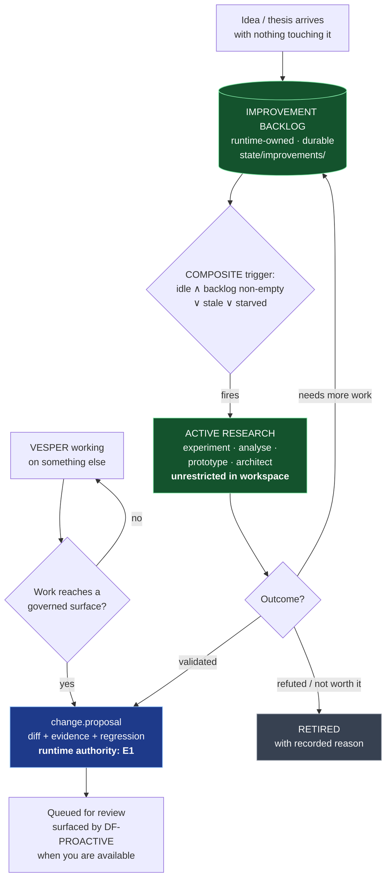

# REM-015 — Improvement backlog, idle-time research, and bounded self-tuning

| | |
|---|---|
| **Implements** | Owner requirement, 2026-08-12 · SR-027, SR-042, SR-044, SR-048 |
| **Extends** | REM-004 §4.4a (proposal timing) · REM-007 (triggers) · REM-012 §1 (learning boundary) |
| **Owner** | Autonomy & Task Engineer · Security Engineer (the tunable boundary) |
| **Blocked by** | REM-004, REM-007, REM-012 |

---

## 1. Problem

REM-004 §4.4a specified **one** path from idea to change: VESPER is doing work, that work reaches a governed surface, `DF-GOVERNED-WRITE` refuses the write, and a proposal is filed. Event-driven, immediate, correct.

**It has a hole.** It only fires when the improvement is a *by-product of work already underway*. An idea that arrives on its own — a hypothesis about a better retrieval strategy, a suspicion that the router is mis-classifying a task class, an architectural thesis with nothing currently touching it — has nowhere to go. Under the current specification it is either acted on immediately (wrong: unvalidated, and it interrupts the work in hand) or lost.

That is a direct under-service of the source:

> **SR-044** — *"conduct real 'professor/scientific' research on subjects or questions **he has** (either on free time or when I ask), and do anything possible… **WHATEVER**."*

*Questions he has.* The corpus authorizes VESPER to hold its own open questions and pursue them in free time. Nothing in the architecture gave those questions a home.

**Owner requirement, 2026-08-12:**

> *"whenever it has an idea or thesis about improvement, it should log it somewhere dedicated, and keep the 'act when working' stuff, and add a schedule for it to go check the ones that came from ideas and thesis whenever it has nothing to do and actively work on them — make experiments, think, research, analyse, architecture them however it wants — and when I'm available, it could then notify me about the result. The schedule can be modifiable by Vesper itself because time is relative; we could make the schedule only make it get back to them when it has been a long time, or work that prevented it from doing it."*

## 2. The one place this specification departs from the owner's wording

The requirement says *"add a schedule"*. Built literally as a `SCHEDULE`-class trigger, this would be the exact anti-pattern REM-008 exists to exclude — and it would weaken `A-029`, because the backlog sweep would fire because a time arrived rather than because the world changed.

**But the owner's own description is already a state predicate**, twice over:

| Owner's words | Predicate class |
|---|---|
| *"whenever it has nothing to do"* | `STATE` — idle, and the backlog is non-empty |
| *"when it has been a long time"* | `STATE` — staleness of the oldest viable idea |
| *"or work that prevented it from doing it"* | `STATE` — starvation: the backlog was skipped because work pre-empted it |

So this is implemented as a **`COMPOSITE`** trigger over those three predicates. That is not a reinterpretation — it is the mechanism that does what was described, and it is strictly stronger than a clock: a timer fires at 03:00 whether or not VESPER is busy; this fires when VESPER is *actually free*, which is what was asked for.

> **Bonus, and it is not cosmetic.** This makes the shipped trigger registry contain a real non-`SCHEDULE` trigger by default, so `CI-026` and `A-029` part 3 are satisfied by a **product feature** rather than by a test fixture. The anti-cron property is now load-bearing in something the owner actually wanted.

## 3. Required behaviour

### 3.1 Two paths in, one path out



**Both paths converge on `change.proposal`.** The backlog is not a shortcut around REM-004: an idea that matures into a governed change traverses exactly the same gate, with exactly the same human merge. What the backlog changes is *when VESPER thinks*, never *what it may apply*.

### 3.2 `ImprovementIdea`

Logged **immediately** on arrival — the moment the thought exists, not when it is convenient. An idea VESPER had and did not record is indistinguishable from one it never had.

```
ImprovementIdea {
  idea_id, schema_version, created_at_hlc,
  title, thesis,                 # what is believed, stated falsifiably where possible
  origin,                        # observation | failure | outcome_analysis |
                                 # research | user_remark | self_reflection
  provenance,                    # what prompted it: event ids, task ids, evidence refs
  target_surface,                # which subsystem or governed surface it would touch
  expected_value, confidence, effort_estimate,
  status,                        # SM-IDEA
  revisit_after,                 # BOUNDED TUNABLE -- see 3.5
  attempts,                      # each with what was tried and what was learned
  supersedes,                    # RB-029: refinement is recorded, not silent replacement
  disposition_reason             # MANDATORY on RETIRED
}
```

### 3.3 Idle-time research — what VESPER may do with a fired idea

Everything, in the workspace, unattended:

- design and run experiments; build prototypes and throw them away;
- research literature and prior art, browse, read papers;
- analyse its own telemetry for evidence for or against the thesis;
- draft architecture, write and benchmark competing implementations;
- **conclude the thesis is wrong** and retire the idea.

This is `INV-SELF-7` applied to the backlog: the runtime workspace is unrestricted, including for work targeting governed surfaces. What it may not do is merge.

**Bounded by the ordinary autonomy controls, with no exceptions carved out:** the trigger's `resource_budget` and `stop_conditions` (RB-035), the cost policy — `FREE_TIME` means free/local models only (`INV-COST-1`) — the enable token (`INV-STOP-1`), and the taint ceiling if the research reads external content (`INV-AUTH-3`).

> **Idle is not a licence.** Having nothing else to do expands *time*, never *authority*.

### 3.4 Notifying you

A completed investigation produces a result, and the result is surfaced through the **existing** interruption machinery (REM-007 §4.6) — not a new path:

```
DF-PROACTIVE(expected_value, decays=false, interruption_cost, ...)
    -> QUEUE_TO_BOUNDARY
```

A research finding does **not decay**, so it queues for the next natural interaction boundary rather than interrupting you. That is precisely *"when I'm available"*. A finding that *does* decay — a security weakness with an active exploit path — carries `decays=true` and can surface immediately. The distinction is already in the decision function; nothing new is required.

**High-value non-decaying findings are never dropped** (`INV-TRIG-3`). The backlog cannot silently swallow a good result.

### 3.5 Bounded self-tuning — *"time is relative"*

The owner asked that VESPER be able to modify its own revisit timing. `INV-TRIG-7` says a model may propose a trigger but may not be one, and `autonomy/triggers/` is governed surface 7. Both are satisfied by separating **the tunable** from **its range**:

| Field | Who may change it | Why |
|---|---|---|
| `revisit_after` on an idea | **VESPER, freely, within the declared range** | This is the "time is relative" clause. Learning that a class of idea needs three weeks rather than three days is exactly the learning SR-048 authorizes. |
| `idle_threshold`, `staleness_floor`, `starvation_count` | **VESPER, within declared min/max** | Same reasoning |
| **The declared min/max range itself** | **Owner only** — governed surface 7 | The bound is the control. A tunable that can widen its own bounds is not bounded. |
| The predicate, `required_authority`, `resource_budget`, `cost_policy`, `actuation_scope` | **Owner only** — proposal path | These are the safety envelope, not the pacing |

```
DF-TUNABLE(field, proposed_value, declared_range) -> ACCEPT | CLAMP | REFUSE_AND_PROPOSE

  if field not in TUNABLE_FIELDS:            return REFUSE_AND_PROPOSE
  if proposed_value within declared_range:   return ACCEPT
  return CLAMP(nearest_bound) + emit(autonomy.tunable_clamped)
      # Clamping is REPORTED. A silent clamp would let VESPER believe it had
      # adjusted something it had not, and act on a false model of itself.
```

Every tuning writes an audit record with its rationale, so *"why does it now wait a month before revisiting this?"* is answerable.

Recommended initial ranges (owner-tunable, and the *range* is the owner's call, not VESPER's):

| Field | Min | Max | Default |
|---|---|---|---|
| `revisit_after` | 1 h | 180 d | 7 d |
| `idle_threshold` | 5 min | 4 h | 20 min |
| `staleness_floor` | 1 d | 365 d | 30 d |
| `starvation_count` | 2 | 50 | 5 |

### 3.6 Ideas do not rot silently

An unbounded backlog becomes a graveyard, and a graveyard is indistinguishable from a system that has stopped thinking.

- Every idea carries `revisit_after`. On expiry it becomes eligible again, not forgotten.
- An idea attempted `MAX_ATTEMPTS` times without progress is **retired with a recorded reason**, never dropped.
- Retirement is auditable and reversible: the record survives, and a retired idea can be revived by new evidence.
- `RETIRED` **requires** `disposition_reason`. A backlog entry that vanished without a reason is a defect, and the schema refuses it.

## 4. State machine — `SM-IDEA`

| From | Event | Guard | To |
|---|---|---|---|
| — | idea logged | schema-valid, provenance present | `LOGGED` |
| `LOGGED` | trigger fires | `DF-IDEA-REVISIT` selects it | `INVESTIGATING` |
| `INVESTIGATING` | thesis supported | evidence recorded | `VALIDATED` |
| `INVESTIGATING` | thesis refuted | reason recorded | `RETIRED` |
| `INVESTIGATING` | inconclusive, budget spent | attempt recorded | `LOGGED` |
| `INVESTIGATING` | pre-empted by user work / stop engaged | — | `LOGGED` *(starvation counter increments)* |
| `VALIDATED` | proposal emitted | `change.proposal` created | `PROPOSED` |
| `VALIDATED` | no governed change needed | applied in workspace | `APPLIED` |
| `PROPOSED` | human merges | — | `MERGED` |
| `PROPOSED` | human refuses | reason recorded | `RETIRED` |
| `LOGGED` | `attempts >= MAX_ATTEMPTS` | — | `RETIRED` |
| `RETIRED` | new evidence | human or trigger | `LOGGED` |

**Prohibited:** any transition from `VALIDATED` or `PROPOSED` directly to a governing surface. `MERGED` is reachable only through the REM-004 human path (`SM-PROPOSAL`).

## 5. The shipped trigger

```
Trigger {
  trigger_id: trg_improvement_backlog
  predicate_class: COMPOSITE          # <-- non-SCHEDULE. CI-026, A-029 part 3.
  predicate:
      backlog.count(status=LOGGED, revisit_due=true) > 0
      AND (
            tasks.count(state=RUNNING, priority>=active_user_task) == 0
              AND schedule.elapsed_since(last_user_interaction) > idle_threshold
        OR  backlog.oldest_due_age > staleness_floor
        OR  backlog.max_starvation_count > starvation_count
      )
  referenced_subjects: [backlog, tasks, user_presence]
  required_authority: L2
  actuation_scope: AUTONOMOUS_ACTUATION
  priority: proactive
  proactive_economics: { decays: false, ... }
  provenance: authored
}
```

The three disjuncts are the owner's three conditions, in order: *nothing to do* · *it has been a long time* · *work kept preventing it*.

## 6. Invariants

| ID | Statement |
|---|---|
| **INV-IDEA-1** | An improvement idea is logged at the moment it arises, with provenance. Ideas are never held only in a model context. |
| **INV-IDEA-2** | The backlog is **runtime-owned and freely writable**; it is not a governed surface. Logging an idea about a governed surface is unrestricted. |
| **INV-IDEA-3** | An idea that matures into a change to a governed surface traverses the **same** proposal path as any other (`INV-SELF-1`). The backlog is never a shortcut. |
| **INV-IDEA-4** | Retirement requires a recorded `disposition_reason`. No idea leaves the backlog silently. |
| **INV-IDEA-5** | The backlog trigger's `predicate_class` is non-`SCHEDULE`. A clock alone may never cause backlog work to begin. |
| **INV-IDEA-6** | Idle time expands available time, never authority: budget, cost policy, enable token and taint ceiling apply unchanged. |
| **INV-TUNE-1** | VESPER may modify a declared tunable **within its declared range**. It may never modify the range, the predicate, the authority, the budget or the cost policy. Out-of-range values are clamped **and reported**, never silently accepted. |

## 7. Failure behaviour

| Failure | Behaviour |
|---|---|
| Backlog store unwritable | Idea logging fails **loudly** (`autonomy.idea_log_unavailable`). VESPER does not proceed to act on an unlogged idea — an unrecorded idea acted on is exactly the drift this REM prevents. |
| Investigation pre-empted by user work | Idea returns to `LOGGED`, starvation counter increments — which is what eventually re-fires the trigger. Work is preserved, not restarted. |
| Enable token stale mid-investigation | Actuation halts (`INV-STOP-1`); the idea returns to `LOGGED` with partial findings retained |
| `FREE_TIME` with no free provider | Investigation queues (`autonomy.blocked_on_cost_policy`); the user is **not** woken |
| Backlog grows without bound | Not an error. Ideas expire to eligible, retire on attempt exhaustion, and `DF-IDEA-REVISIT` orders by value — a large backlog degrades throughput, never correctness. |
| VESPER attempts to widen a tunable range | `DF-TUNABLE` returns `REFUSE_AND_PROPOSE`; a proposal is filed instead |
| Idea refuted | `RETIRED` with reason. **This is a success**, and telemetry counts it as one — a system that never refutes its own theses is not investigating them. |

## 8. Verification — `A-049`

| Case | Assertion |
|---|---|
| 49.1 | An idea arising with no related work in flight is **logged immediately** with provenance; nothing is acted on yet |
| 49.2 | With the system idle and the backlog due, the trigger fires — and its `predicate_class` is **non-`SCHEDULE`** |
| 49.3 | With user work running at `active_user_task` priority, the trigger **does not** fire; the starvation counter increments |
| 49.4 | After `starvation_count` pre-emptions, the trigger fires **even though the system is not fully idle** — the owner's *"work that prevented it"* clause |
| 49.5 | After `staleness_floor`, an idea becomes eligible **even if never starved** — the *"it has been a long time"* clause |
| 49.6 | An investigation reaching a governed surface produces a `change.proposal`, **not** an applied change (`INV-IDEA-3`) |
| 49.7 | A completed non-decaying finding **queues to the next interaction boundary**; it does not interrupt |
| 49.8 | A refuted thesis retires **with a recorded reason**; it is counted as a completed investigation, not a failure |
| 49.9 | VESPER sets `revisit_after` inside its range ⇒ **accepted**. Outside ⇒ **clamped and reported**. Attempt to alter the range itself ⇒ **refused, proposal filed** |
| 49.10 | Backlog store made unwritable ⇒ idea logging fails loudly and no unlogged idea is acted on |
| 49.11 | Investigation during `FREE_TIME` uses only free/local models; **zero paid calls at the gateway boundary** |

**Negative controls (mandatory).**
- A build whose backlog sweep is a `SCHEDULE` trigger must **FAIL** 49.2, 49.3 and 49.4 — it fires on the clock regardless of whether VESPER is busy, which is the behaviour the owner explicitly did not ask for.
- A build permitting range self-modification must **FAIL** 49.9.

## 9. CI enforcement

| Check | Enforces |
|---|---|
| `CI-026` `non-schedule-trigger-present` | Now satisfied by a **shipped product feature** rather than a fixture — `trg_improvement_backlog` is `COMPOSITE` |
| `CI-046` `tunable-range-immutable` *(new, PENDING)* | `INV-TUNE-1` — structural: no runtime path writes a tunable's declared min/max |
| `CI-047` `idea-retirement-reason` *(new, PENDING)* | `INV-IDEA-4` — no transition to `RETIRED` without `disposition_reason` |
| `CI-015` `no-runtime-governed-write` | `INV-IDEA-3` — the backlog cannot bypass the proposal path |

## 10. Unresolved decisions

| # | Item | Disposition |
|---|---|---|
| 1 | Tunable range values in §3.5 | Owner sets the ranges; VESPER moves within them. Defaults proposed. |
| 2 | `MAX_ATTEMPTS` before retirement | Proposed 5. Tunable within 2–20. |
| 3 | Whether refuted ideas should be surfaced to the owner at all | Recommended **yes, in digest form** — knowing what VESPER tried and rejected is how the owner calibrates trust in what it proposes. Non-decaying, so it queues. |

## 11. Jarvis-divergence check

> *Could an implementation agent satisfy REM-015 while building an ordinary chatbot?*

**No, and this is one of the sharper cases in the corpus.** The clause that prevents it: **`INV-IDEA-1` combined with the `COMPOSITE` trigger** — VESPER holds its own open questions across time, and returns to them *because it noticed it was free*, not because it was asked and not because a clock struck.

A chatbot has no "between". It cannot have an idea on Tuesday, be too busy on Wednesday, notice on Thursday that it has been starved five times, spend Thursday night running experiments on free local models, and hand you a validated proposal on Friday when you are next available. `A-049.4` — fire *because work kept preventing it* — is unstatable in a request-scoped architecture, because there is no continuous self to have been prevented.
